# Diagramas UML del SGB (PlantUML)

Diagramas del Sistema de Gestión Bibliotecaria, hechos a partir del código Python del proyecto (`SGB.py` / `SGB.ipynb`).

## Estructura

```text
Diagramas_SGB/
├── 01_Dominio_Parcial.puml
├── 02_Dominio_Completo.puml
├── 03_Diagrama_Clases.puml            (+ 03a, 03b y 03c: subdiagramas)
├── 04_Diagrama_Objetos.puml
├── 05_Diagramas_Comportamiento/       (6 diagramas de actividad)
├── 06_Diagrama_Secuencia.puml
├── img/                               (cada diagrama en SVG y PNG)
└── README.md
```

## Cómo abrir o modificar el código

- **VS Code:** instala la extensión *PlantUML* (jebbs) y abre un `.puml`; `Alt+D` abre la vista previa. Necesita Java y Graphviz, o un servidor PlantUML.
- **En línea:** pega el contenido del `.puml` en https://www.plantuml.com/plantuml/uml/ o usa el enlace de cada diagrama.
- **Por línea de comandos:** `java -jar plantuml.jar -tsvg archivo.puml`.
- Las imágenes ya renderizadas están en `img/`. Si cambias un `.puml`, vuelve a generarlas.

## Cómo incrustar en Markdown

- Con la imagen local: ``
- Con el servidor: `` (ver cada diagrama).

## Diagramas

### A. Dominio parcial
Usuario, Libro, Prestamo y Multa con sus multiplicidades. Es una vista simplificada del dominio.

- Archivo: `01_Dominio_Parcial.puml`
- Imagen local: `img/01_Dominio_Parcial.svg` y `img/01_Dominio_Parcial.png`
- Ver en línea (SVG): https://www.plantuml.com/plantuml/svg/PLF1ZXen3BtdAonwgxG8MbXL7AgbK4vjjLBLCp8J0zvDuf6JsLLLzODwwAcVm8_LOLYWwitsUtvsdcVkSa4jNGmm6g-N4ZcnhEzH6yRW2fT0i6JSAKO4J-1x1hGzOmQj7dwPH9IA1jwePFWEiGi5iykFd8o94V8UlJnpsi4MGwOhHALBVY6QIE7TLTtJ5arb9QbymKWmrxhH1P-holD2WYYycaocazlv5TW4p1b-E80Fs3pkJZEEt8zlLszMoug8Uj9JTJozdIv6xgVRixsZOMq2zN6aiXUVNQ1jWIAWlDiNyApK59RaN3_hM-vGpPWwCtLnxQNf8gKYDPUuKRAWS5jpCiEysB2-zLDrxTZ8UPEEjDA5IYnICApfWM8RK2bRoNDk9V4cMFOYSA_Kdw1gDE9vLvktrEnntPwmSo5mv4BdrDEJXAwfB_bliS_rYl-AUiQyLYgAkQPFQEvTDxeN7mRZ0TpSm60q7BuUN3QSGPR03PlkUtUkdbYLRssz7pEpWPBTGemWcmSoxwzRBleMzPlQrzYHdMndVOfgT9Ua46oa58aWsvvd-tub43ia9wpx26I6KB_ltel3dzuCQ2KNijSeOCMFZa4u_AuE3Xqb3rNVtLbaVv3x2m00
- Ver en línea (PNG): https://www.plantuml.com/plantuml/png/PLF1ZXen3BtdAonwgxG8MbXL7AgbK4vjjLBLCp8J0zvDuf6JsLLLzODwwAcVm8_LOLYWwitsUtvsdcVkSa4jNGmm6g-N4ZcnhEzH6yRW2fT0i6JSAKO4J-1x1hGzOmQj7dwPH9IA1jwePFWEiGi5iykFd8o94V8UlJnpsi4MGwOhHALBVY6QIE7TLTtJ5arb9QbymKWmrxhH1P-holD2WYYycaocazlv5TW4p1b-E80Fs3pkJZEEt8zlLszMoug8Uj9JTJozdIv6xgVRixsZOMq2zN6aiXUVNQ1jWIAWlDiNyApK59RaN3_hM-vGpPWwCtLnxQNf8gKYDPUuKRAWS5jpCiEysB2-zLDrxTZ8UPEEjDA5IYnICApfWM8RK2bRoNDk9V4cMFOYSA_Kdw1gDE9vLvktrEnntPwmSo5mv4BdrDEJXAwfB_bliS_rYl-AUiQyLYgAkQPFQEvTDxeN7mRZ0TpSm60q7BuUN3QSGPR03PlkUtUkdbYLRssz7pEpWPBTGemWcmSoxwzRBleMzPlQrzYHdMndVOfgT9Ua46oa58aWsvvd-tub43ia9wpx26I6KB_ltel3dzuCQ2KNijSeOCMFZa4u_AuE3Xqb3rNVtLbaVv3x2m00
- Editar en línea: https://www.plantuml.com/plantuml/uml/PLF1ZXen3BtdAonwgxG8MbXL7AgbK4vjjLBLCp8J0zvDuf6JsLLLzODwwAcVm8_LOLYWwitsUtvsdcVkSa4jNGmm6g-N4ZcnhEzH6yRW2fT0i6JSAKO4J-1x1hGzOmQj7dwPH9IA1jwePFWEiGi5iykFd8o94V8UlJnpsi4MGwOhHALBVY6QIE7TLTtJ5arb9QbymKWmrxhH1P-holD2WYYycaocazlv5TW4p1b-E80Fs3pkJZEEt8zlLszMoug8Uj9JTJozdIv6xgVRixsZOMq2zN6aiXUVNQ1jWIAWlDiNyApK59RaN3_hM-vGpPWwCtLnxQNf8gKYDPUuKRAWS5jpCiEysB2-zLDrxTZ8UPEEjDA5IYnICApfWM8RK2bRoNDk9V4cMFOYSA_Kdw1gDE9vLvktrEnntPwmSo5mv4BdrDEJXAwfB_bliS_rYl-AUiQyLYgAkQPFQEvTDxeN7mRZ0TpSm60q7BuUN3QSGPR03PlkUtUkdbYLRssz7pEpWPBTGemWcmSoxwzRBleMzPlQrzYHdMndVOfgT9Ua46oa58aWsvvd-tub43ia9wpx26I6KB_ltel3dzuCQ2KNijSeOCMFZa4u_AuE3Xqb3rNVtLbaVv3x2m00
- Para incrustar:

```markdown

```

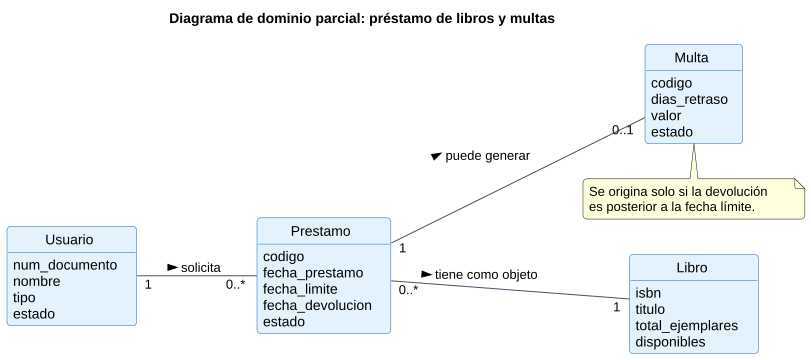

### B. Dominio completo
Las seis entidades (Usuario, Categoria, Libro, Prestamo, Multa, Reserva), atributos y multiplicidades.

- Archivo: `02_Dominio_Completo.puml`
- Imagen local: `img/02_Dominio_Completo.svg` y `img/02_Dominio_Completo.png`
- Ver en línea (SVG): https://www.plantuml.com/plantuml/svg/TLJ1JXmn3BtdAwpj1Ig1W0Agzb01I-7ILbKHvv4tuvqrPEAHau43wYVrr4_Wn-hCBCj2uJHs_FniFoTpaZ9gxji0UmVLkRGSMQgPj5sWB2vp3WJdZ8rYYr0Jr2C4_0eoXIjEcSRW9QNCZtyZdF4yi6Jog8omTNLvjktIBSSEZGVI4ckvvzZ00aEYZOXA7-kPQ2I5pnldDIsm3_b2Olw1BS6fqOQD-AcgtCyaYCA7myEZm-FJZQ0Fc18yE80pzBVDgiQ0_Vhfuk3Yl4H4QzBLwVxHyT5ip_rsIxQXFAiFDDejvQNKoRcHyphrDg0CtB5lgrfytr8quSoNTgvaHkQk-5vKgHYP0Yqa5jFaCYMiq4WtmqoD5CKUXeIQcnTCDIMlt7cMkCxvndCT6-0qZqEvt8UIXdqMBLzRLpcNZA6Y6xAzeL8gV9mwYROgyvxuVcffgfMNBIp8Bx7gLh7rGU2MCwtTckuaz4Dx_ytstTRtQgwQCLLAMJ4Lzmx3qE-hn5-KIE_mhNvq36tck6SD9_iJsDc1oTxkxiV9IgSfs4tkEuGlxcbtBs7hyQUG9B3d_3xsgRCfBD6JmSOQxn9I0fdVs9ifJ-Ljz3FbA_2QPWDlrgZg5BgU3DQGlHjKWxjeZm-KcsK6MOp3cqpN4S9GjIFD1hQk4Vg8PLO4Fqht-ASekeLPUMvNg8XU-RMg5842-CU_PHFRkuvY3QMOEp7BVYFk7m00
- Ver en línea (PNG): https://www.plantuml.com/plantuml/png/TLJ1JXmn3BtdAwpj1Ig1W0Agzb01I-7ILbKHvv4tuvqrPEAHau43wYVrr4_Wn-hCBCj2uJHs_FniFoTpaZ9gxji0UmVLkRGSMQgPj5sWB2vp3WJdZ8rYYr0Jr2C4_0eoXIjEcSRW9QNCZtyZdF4yi6Jog8omTNLvjktIBSSEZGVI4ckvvzZ00aEYZOXA7-kPQ2I5pnldDIsm3_b2Olw1BS6fqOQD-AcgtCyaYCA7myEZm-FJZQ0Fc18yE80pzBVDgiQ0_Vhfuk3Yl4H4QzBLwVxHyT5ip_rsIxQXFAiFDDejvQNKoRcHyphrDg0CtB5lgrfytr8quSoNTgvaHkQk-5vKgHYP0Yqa5jFaCYMiq4WtmqoD5CKUXeIQcnTCDIMlt7cMkCxvndCT6-0qZqEvt8UIXdqMBLzRLpcNZA6Y6xAzeL8gV9mwYROgyvxuVcffgfMNBIp8Bx7gLh7rGU2MCwtTckuaz4Dx_ytstTRtQgwQCLLAMJ4Lzmx3qE-hn5-KIE_mhNvq36tck6SD9_iJsDc1oTxkxiV9IgSfs4tkEuGlxcbtBs7hyQUG9B3d_3xsgRCfBD6JmSOQxn9I0fdVs9ifJ-Ljz3FbA_2QPWDlrgZg5BgU3DQGlHjKWxjeZm-KcsK6MOp3cqpN4S9GjIFD1hQk4Vg8PLO4Fqht-ASekeLPUMvNg8XU-RMg5842-CU_PHFRkuvY3QMOEp7BVYFk7m00
- Editar en línea: https://www.plantuml.com/plantuml/uml/TLJ1JXmn3BtdAwpj1Ig1W0Agzb01I-7ILbKHvv4tuvqrPEAHau43wYVrr4_Wn-hCBCj2uJHs_FniFoTpaZ9gxji0UmVLkRGSMQgPj5sWB2vp3WJdZ8rYYr0Jr2C4_0eoXIjEcSRW9QNCZtyZdF4yi6Jog8omTNLvjktIBSSEZGVI4ckvvzZ00aEYZOXA7-kPQ2I5pnldDIsm3_b2Olw1BS6fqOQD-AcgtCyaYCA7myEZm-FJZQ0Fc18yE80pzBVDgiQ0_Vhfuk3Yl4H4QzBLwVxHyT5ip_rsIxQXFAiFDDejvQNKoRcHyphrDg0CtB5lgrfytr8quSoNTgvaHkQk-5vKgHYP0Yqa5jFaCYMiq4WtmqoD5CKUXeIQcnTCDIMlt7cMkCxvndCT6-0qZqEvt8UIXdqMBLzRLpcNZA6Y6xAzeL8gV9mwYROgyvxuVcffgfMNBIp8Bx7gLh7rGU2MCwtTckuaz4Dx_ytstTRtQgwQCLLAMJ4Lzmx3qE-hn5-KIE_mhNvq36tck6SD9_iJsDc1oTxkxiV9IgSfs4tkEuGlxcbtBs7hyQUG9B3d_3xsgRCfBD6JmSOQxn9I0fdVs9ifJ-Ljz3FbA_2QPWDlrgZg5BgU3DQGlHjKWxjeZm-KcsK6MOp3cqpN4S9GjIFD1hQk4Vg8PLO4Fqht-ASekeLPUMvNg8XU-RMg5842-CU_PHFRkuvY3QMOEp7BVYFk7m00
- Para incrustar:

```markdown

```

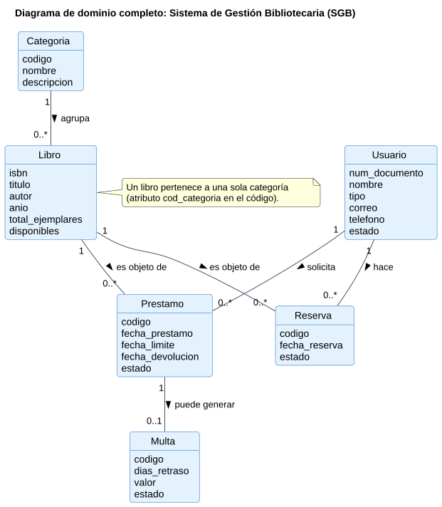

### C. Diagrama de clases general
Las tres capas (Modelo, Repositorios, Servicios), con enumeraciones, métodos y dependencias entre servicios y repositorios.

- Archivo: `03_Diagrama_Clases.puml`
- Imagen local: `img/03_Diagrama_Clases.svg` y `img/03_Diagrama_Clases.png`
- Ver en línea (SVG): https://www.plantuml.com/plantuml/svg/hLdRRjiu47tNLn39YuEasQJfTjCy57LifGYG6tB3lWcqH3jiAL4WgRHfaQ_QJzWVs-5DeYwsctIVB0rdXZE7Sz7GdwJ2GbKvGti7oPJYXS0vJYOCIo8ZHHKZo5DHHb1g5j2254HWTeHkFXyZKY0bW9ZY4ij8VgL5YO4VoGUSyM-qMA0vPf84Au9NHJRX0fIWmu2UaJckc3hXXRh0EK5ZGJ4BriT2y6yJphX0c-_U_Vdk_JXOrAR9iLA2pYf5JbDUtD0V1Eq5B2LEl-85kL5Fu9OWgSB5WeM65JmZafJe89GIkFYgYU_teWSA692yL4ye9_cC21anCbT8SIJeua6XZ6grb1UHsmjjJ00M3TqD4OyqfLoY4VltdmLD3RKW2mx4hGs49RgwYQ_lqUR9oSbXl8z-HiWwXUvaXGNbLWFH3F7UyLl3WD2s80igbS1YL5Hval6qoacX-0vuayy4sK6Abl2MSY48_2e29lE2Rw4ZhzZgcLKonI8fkMYKZE2fnuXJLM56Vy2EiDpNl8C8H5NMtu5H7Ms9uXcN8xsg2R3qN7jwHcTYhPz9YXN01i4nIdb65u6hS7ofe2KWMcZz4y_OshyMRndHGfBAMQ61KnK3xRXIN6W_iqOMg0NLJdE5MKA-G5Gm36cWDHelUg1gdKRnSXQxuKXzLst3dE6QfUNx85T6PSaBEcDa2SXNGfzFlWndo40ADI27NmpYv_hNhBn9824aWItc97t08qM-AtF86TW4CiHpEVqoaRH8ClB8sICHFfGQUorVBsmjzcQBMfKMz6PRuLgj3m4hOCYLF_-sI02q5NAoVSu7i55Zp9BAnc_VU0Vs8obIgiFPR3y8jm5m2TOfPca5SMFH7eNkDhXlbtY1ZQEMhRFgWuCK6GK4YLnYT6FHDHGvyOYNvfbPNNakZaThTygyFqLA61O1igtr892Ppe0w7nfWOR-IKG6niwYCFpLFewbnPLn09P9KJh7YSfb3bMeYIO8YoF5WnHZI9pTLehVayEqlcEDfaQto9CVIML37Ia8Bwk6SKrrjU9aKGncYCwcT-cskdCCMDCEPgo4bTpj0OLR492XD7MzM2Qop0wpXESaehu4nIbLLCkB3eDJYpgTHeEOvUkwtjsjWbrHdZUvm9RH6i4yd1tQzxJg-keIJsOVUzY7eRMEHFj17VgSeGvkJm_Zzv8CxjvzWbgBfCzectxMkaOPOcp7Zd7KuKg7BagH9mPFrt8mG7Ny50RyyMmrdiAtk9JFgM0td3ZBFMnrEGJnlo2MxRFQpgQu-WFoSVZ59OkFbkTlnQr2VqEPq4aydXs5CXt6s0FuCygwoUsv3H6N9x6bD9pTScB5EG0KDlWeWRCoh--hB3Kmx1ZQLUA1X3zdN-LXukGLiQwNpth1bxTglB-lLjMFB6tM0Bnl4rtUZbpjN_ffpRTJRpS_pB6rzdc5P1G_SAmVTCythvRxbh_4jQ9IUeQvuIrZMTjAMZucjwbfP-E7RSzfrhvUxBLxZTglh_lg1hNDceF2Vmyp4E0A8SkXeVf8vlvoYpVZWvEt9j3_8eCtZusbySkmzRtreX13Op_gGehiRlD_2ZrCMWxJxSZ1pI8lRJIGXpNeLKXBTYbMIl6n-gl5nMt7N9hO2rKtfdqExTGosWxHAyK1bxM9aZtSrEC7qC-ZVgcdfrLw49RjJcxi-wCXh7wOkeI75J5eXeJLpjJWXrk2T5ifRtfx3mhLW8Wh9DIwld_O0mqRtwp7qxQNV0TQ7GHVKfSdKdgZwAupcL94-lHcf1jCeDW_UtYORUr5dKUxaMDie_svDwSzqlvzpGQlhzAFrIEk8688lWna19Y8bi6o5v2Dc9fXhGWSpi-qAmCBzTA0rk-mWe_ltuV2jhzUc_lUuSnFZYX1oExykWfpwtqUaFMGIsApRRA2lxH_7yLyEclZczcvwEhwuZSthz78I--Vuxzlu-k8orDNFbewwyUJszFxIgehlx-ApM_jo7rzCJgS3kkeewYYwYY-cfxKfL-FFu-cuBns0FcJ8s3nExiwlpawdxcLyCOdFlBBdoFVqDsy-zf0wChqpgekPvXb0uCYTMcGJiU5gVAjPV7msJA4BDLldobHpzsUg8wI7tAXrwQWvkuE5vNCN1NtseMd8YJIN257trarB3dpdEy5wyX-KM-PAVJCnABNQhQx4njxkxlw64Un-hpj1UpEmLj3JZv0HIAHzNoNNkQ3I-nb2BTjIlDx47lkl0Dyn8h2hB-Ni6nHQVrW3GglFQl3MQtVtO-is1Rxm2K6CIxGBGoegeHVf4IEoDp6QstobGuusLV8F5DJ4hQZWy44muqhn7F6vlSE1j9_W31jxt8KFgYHkRVq4lQk0Ubiz4SHdNmXOgKS5MK7fKVgc2fICCWBVKepe_u_s3ln_JeaT9vAd9BnGsYshd6tjHZ2O8MrJz0cUW1Jz1m00
- Ver en línea (PNG): https://www.plantuml.com/plantuml/png/hLdRRjiu47tNLn39YuEasQJfTjCy57LifGYG6tB3lWcqH3jiAL4WgRHfaQ_QJzWVs-5DeYwsctIVB0rdXZE7Sz7GdwJ2GbKvGti7oPJYXS0vJYOCIo8ZHHKZo5DHHb1g5j2254HWTeHkFXyZKY0bW9ZY4ij8VgL5YO4VoGUSyM-qMA0vPf84Au9NHJRX0fIWmu2UaJckc3hXXRh0EK5ZGJ4BriT2y6yJphX0c-_U_Vdk_JXOrAR9iLA2pYf5JbDUtD0V1Eq5B2LEl-85kL5Fu9OWgSB5WeM65JmZafJe89GIkFYgYU_teWSA692yL4ye9_cC21anCbT8SIJeua6XZ6grb1UHsmjjJ00M3TqD4OyqfLoY4VltdmLD3RKW2mx4hGs49RgwYQ_lqUR9oSbXl8z-HiWwXUvaXGNbLWFH3F7UyLl3WD2s80igbS1YL5Hval6qoacX-0vuayy4sK6Abl2MSY48_2e29lE2Rw4ZhzZgcLKonI8fkMYKZE2fnuXJLM56Vy2EiDpNl8C8H5NMtu5H7Ms9uXcN8xsg2R3qN7jwHcTYhPz9YXN01i4nIdb65u6hS7ofe2KWMcZz4y_OshyMRndHGfBAMQ61KnK3xRXIN6W_iqOMg0NLJdE5MKA-G5Gm36cWDHelUg1gdKRnSXQxuKXzLst3dE6QfUNx85T6PSaBEcDa2SXNGfzFlWndo40ADI27NmpYv_hNhBn9824aWItc97t08qM-AtF86TW4CiHpEVqoaRH8ClB8sICHFfGQUorVBsmjzcQBMfKMz6PRuLgj3m4hOCYLF_-sI02q5NAoVSu7i55Zp9BAnc_VU0Vs8obIgiFPR3y8jm5m2TOfPca5SMFH7eNkDhXlbtY1ZQEMhRFgWuCK6GK4YLnYT6FHDHGvyOYNvfbPNNakZaThTygyFqLA61O1igtr892Ppe0w7nfWOR-IKG6niwYCFpLFewbnPLn09P9KJh7YSfb3bMeYIO8YoF5WnHZI9pTLehVayEqlcEDfaQto9CVIML37Ia8Bwk6SKrrjU9aKGncYCwcT-cskdCCMDCEPgo4bTpj0OLR492XD7MzM2Qop0wpXESaehu4nIbLLCkB3eDJYpgTHeEOvUkwtjsjWbrHdZUvm9RH6i4yd1tQzxJg-keIJsOVUzY7eRMEHFj17VgSeGvkJm_Zzv8CxjvzWbgBfCzectxMkaOPOcp7Zd7KuKg7BagH9mPFrt8mG7Ny50RyyMmrdiAtk9JFgM0td3ZBFMnrEGJnlo2MxRFQpgQu-WFoSVZ59OkFbkTlnQr2VqEPq4aydXs5CXt6s0FuCygwoUsv3H6N9x6bD9pTScB5EG0KDlWeWRCoh--hB3Kmx1ZQLUA1X3zdN-LXukGLiQwNpth1bxTglB-lLjMFB6tM0Bnl4rtUZbpjN_ffpRTJRpS_pB6rzdc5P1G_SAmVTCythvRxbh_4jQ9IUeQvuIrZMTjAMZucjwbfP-E7RSzfrhvUxBLxZTglh_lg1hNDceF2Vmyp4E0A8SkXeVf8vlvoYpVZWvEt9j3_8eCtZusbySkmzRtreX13Op_gGehiRlD_2ZrCMWxJxSZ1pI8lRJIGXpNeLKXBTYbMIl6n-gl5nMt7N9hO2rKtfdqExTGosWxHAyK1bxM9aZtSrEC7qC-ZVgcdfrLw49RjJcxi-wCXh7wOkeI75J5eXeJLpjJWXrk2T5ifRtfx3mhLW8Wh9DIwld_O0mqRtwp7qxQNV0TQ7GHVKfSdKdgZwAupcL94-lHcf1jCeDW_UtYORUr5dKUxaMDie_svDwSzqlvzpGQlhzAFrIEk8688lWna19Y8bi6o5v2Dc9fXhGWSpi-qAmCBzTA0rk-mWe_ltuV2jhzUc_lUuSnFZYX1oExykWfpwtqUaFMGIsApRRA2lxH_7yLyEclZczcvwEhwuZSthz78I--Vuxzlu-k8orDNFbewwyUJszFxIgehlx-ApM_jo7rzCJgS3kkeewYYwYY-cfxKfL-FFu-cuBns0FcJ8s3nExiwlpawdxcLyCOdFlBBdoFVqDsy-zf0wChqpgekPvXb0uCYTMcGJiU5gVAjPV7msJA4BDLldobHpzsUg8wI7tAXrwQWvkuE5vNCN1NtseMd8YJIN257trarB3dpdEy5wyX-KM-PAVJCnABNQhQx4njxkxlw64Un-hpj1UpEmLj3JZv0HIAHzNoNNkQ3I-nb2BTjIlDx47lkl0Dyn8h2hB-Ni6nHQVrW3GglFQl3MQtVtO-is1Rxm2K6CIxGBGoegeHVf4IEoDp6QstobGuusLV8F5DJ4hQZWy44muqhn7F6vlSE1j9_W31jxt8KFgYHkRVq4lQk0Ubiz4SHdNmXOgKS5MK7fKVgc2fICCWBVKepe_u_s3ln_JeaT9vAd9BnGsYshd6tjHZ2O8MrJz0cUW1Jz1m00
- Editar en línea: https://www.plantuml.com/plantuml/uml/hLdRRjiu47tNLn39YuEasQJfTjCy57LifGYG6tB3lWcqH3jiAL4WgRHfaQ_QJzWVs-5DeYwsctIVB0rdXZE7Sz7GdwJ2GbKvGti7oPJYXS0vJYOCIo8ZHHKZo5DHHb1g5j2254HWTeHkFXyZKY0bW9ZY4ij8VgL5YO4VoGUSyM-qMA0vPf84Au9NHJRX0fIWmu2UaJckc3hXXRh0EK5ZGJ4BriT2y6yJphX0c-_U_Vdk_JXOrAR9iLA2pYf5JbDUtD0V1Eq5B2LEl-85kL5Fu9OWgSB5WeM65JmZafJe89GIkFYgYU_teWSA692yL4ye9_cC21anCbT8SIJeua6XZ6grb1UHsmjjJ00M3TqD4OyqfLoY4VltdmLD3RKW2mx4hGs49RgwYQ_lqUR9oSbXl8z-HiWwXUvaXGNbLWFH3F7UyLl3WD2s80igbS1YL5Hval6qoacX-0vuayy4sK6Abl2MSY48_2e29lE2Rw4ZhzZgcLKonI8fkMYKZE2fnuXJLM56Vy2EiDpNl8C8H5NMtu5H7Ms9uXcN8xsg2R3qN7jwHcTYhPz9YXN01i4nIdb65u6hS7ofe2KWMcZz4y_OshyMRndHGfBAMQ61KnK3xRXIN6W_iqOMg0NLJdE5MKA-G5Gm36cWDHelUg1gdKRnSXQxuKXzLst3dE6QfUNx85T6PSaBEcDa2SXNGfzFlWndo40ADI27NmpYv_hNhBn9824aWItc97t08qM-AtF86TW4CiHpEVqoaRH8ClB8sICHFfGQUorVBsmjzcQBMfKMz6PRuLgj3m4hOCYLF_-sI02q5NAoVSu7i55Zp9BAnc_VU0Vs8obIgiFPR3y8jm5m2TOfPca5SMFH7eNkDhXlbtY1ZQEMhRFgWuCK6GK4YLnYT6FHDHGvyOYNvfbPNNakZaThTygyFqLA61O1igtr892Ppe0w7nfWOR-IKG6niwYCFpLFewbnPLn09P9KJh7YSfb3bMeYIO8YoF5WnHZI9pTLehVayEqlcEDfaQto9CVIML37Ia8Bwk6SKrrjU9aKGncYCwcT-cskdCCMDCEPgo4bTpj0OLR492XD7MzM2Qop0wpXESaehu4nIbLLCkB3eDJYpgTHeEOvUkwtjsjWbrHdZUvm9RH6i4yd1tQzxJg-keIJsOVUzY7eRMEHFj17VgSeGvkJm_Zzv8CxjvzWbgBfCzectxMkaOPOcp7Zd7KuKg7BagH9mPFrt8mG7Ny50RyyMmrdiAtk9JFgM0td3ZBFMnrEGJnlo2MxRFQpgQu-WFoSVZ59OkFbkTlnQr2VqEPq4aydXs5CXt6s0FuCygwoUsv3H6N9x6bD9pTScB5EG0KDlWeWRCoh--hB3Kmx1ZQLUA1X3zdN-LXukGLiQwNpth1bxTglB-lLjMFB6tM0Bnl4rtUZbpjN_ffpRTJRpS_pB6rzdc5P1G_SAmVTCythvRxbh_4jQ9IUeQvuIrZMTjAMZucjwbfP-E7RSzfrhvUxBLxZTglh_lg1hNDceF2Vmyp4E0A8SkXeVf8vlvoYpVZWvEt9j3_8eCtZusbySkmzRtreX13Op_gGehiRlD_2ZrCMWxJxSZ1pI8lRJIGXpNeLKXBTYbMIl6n-gl5nMt7N9hO2rKtfdqExTGosWxHAyK1bxM9aZtSrEC7qC-ZVgcdfrLw49RjJcxi-wCXh7wOkeI75J5eXeJLpjJWXrk2T5ifRtfx3mhLW8Wh9DIwld_O0mqRtwp7qxQNV0TQ7GHVKfSdKdgZwAupcL94-lHcf1jCeDW_UtYORUr5dKUxaMDie_svDwSzqlvzpGQlhzAFrIEk8688lWna19Y8bi6o5v2Dc9fXhGWSpi-qAmCBzTA0rk-mWe_ltuV2jhzUc_lUuSnFZYX1oExykWfpwtqUaFMGIsApRRA2lxH_7yLyEclZczcvwEhwuZSthz78I--Vuxzlu-k8orDNFbewwyUJszFxIgehlx-ApM_jo7rzCJgS3kkeewYYwYY-cfxKfL-FFu-cuBns0FcJ8s3nExiwlpawdxcLyCOdFlBBdoFVqDsy-zf0wChqpgekPvXb0uCYTMcGJiU5gVAjPV7msJA4BDLldobHpzsUg8wI7tAXrwQWvkuE5vNCN1NtseMd8YJIN257trarB3dpdEy5wyX-KM-PAVJCnABNQhQx4njxkxlw64Un-hpj1UpEmLj3JZv0HIAHzNoNNkQ3I-nb2BTjIlDx47lkl0Dyn8h2hB-Ni6nHQVrW3GglFQl3MQtVtO-is1Rxm2K6CIxGBGoegeHVf4IEoDp6QstobGuusLV8F5DJ4hQZWy44muqhn7F6vlSE1j9_W31jxt8KFgYHkRVq4lQk0Ubiz4SHdNmXOgKS5MK7fKVgc2fICCWBVKepe_u_s3ln_JeaT9vAd9BnGsYshd6tjHZ2O8MrJz0cUW1Jz1m00
- Para incrustar:

```markdown
![C. Diagrama de clases general](https://www.plantuml.com/plantuml/svg/hLdRRjiu47tNLn39YuEasQJfTjCy57LifGYG6tB3lWcqH3jiAL4WgRHfaQ_QJzWVs-5DeYwsctIVB0rdXZE7Sz7GdwJ2GbKvGti7oPJYXS0vJYOCIo8ZHHKZo5DHHb1g5j2254HWTeHkFXyZKY0bW9ZY4ij8VgL5YO4VoGUSyM-qMA0vPf84Au9NHJRX0fIWmu2UaJckc3hXXRh0EK5ZGJ4BriT2y6yJphX0c-_U_Vdk_JXOrAR9iLA2pYf5JbDUtD0V1Eq5B2LEl-85kL5Fu9OWgSB5WeM65JmZafJe89GIkFYgYU_teWSA692yL4ye9_cC21anCbT8SIJeua6XZ6grb1UHsmjjJ00M3TqD4OyqfLoY4VltdmLD3RKW2mx4hGs49RgwYQ_lqUR9oSbXl8z-HiWwXUvaXGNbLWFH3F7UyLl3WD2s80igbS1YL5Hval6qoacX-0vuayy4sK6Abl2MSY48_2e29lE2Rw4ZhzZgcLKonI8fkMYKZE2fnuXJLM56Vy2EiDpNl8C8H5NMtu5H7Ms9uXcN8xsg2R3qN7jwHcTYhPz9YXN01i4nIdb65u6hS7ofe2KWMcZz4y_OshyMRndHGfBAMQ61KnK3xRXIN6W_iqOMg0NLJdE5MKA-G5Gm36cWDHelUg1gdKRnSXQxuKXzLst3dE6QfUNx85T6PSaBEcDa2SXNGfzFlWndo40ADI27NmpYv_hNhBn9824aWItc97t08qM-AtF86TW4CiHpEVqoaRH8ClB8sICHFfGQUorVBsmjzcQBMfKMz6PRuLgj3m4hOCYLF_-sI02q5NAoVSu7i55Zp9BAnc_VU0Vs8obIgiFPR3y8jm5m2TOfPca5SMFH7eNkDhXlbtY1ZQEMhRFgWuCK6GK4YLnYT6FHDHGvyOYNvfbPNNakZaThTygyFqLA61O1igtr892Ppe0w7nfWOR-IKG6niwYCFpLFewbnPLn09P9KJh7YSfb3bMeYIO8YoF5WnHZI9pTLehVayEqlcEDfaQto9CVIML37Ia8Bwk6SKrrjU9aKGncYCwcT-cskdCCMDCEPgo4bTpj0OLR492XD7MzM2Qop0wpXESaehu4nIbLLCkB3eDJYpgTHeEOvUkwtjsjWbrHdZUvm9RH6i4yd1tQzxJg-keIJsOVUzY7eRMEHFj17VgSeGvkJm_Zzv8CxjvzWbgBfCzectxMkaOPOcp7Zd7KuKg7BagH9mPFrt8mG7Ny50RyyMmrdiAtk9JFgM0td3ZBFMnrEGJnlo2MxRFQpgQu-WFoSVZ59OkFbkTlnQr2VqEPq4aydXs5CXt6s0FuCygwoUsv3H6N9x6bD9pTScB5EG0KDlWeWRCoh--hB3Kmx1ZQLUA1X3zdN-LXukGLiQwNpth1bxTglB-lLjMFB6tM0Bnl4rtUZbpjN_ffpRTJRpS_pB6rzdc5P1G_SAmVTCythvRxbh_4jQ9IUeQvuIrZMTjAMZucjwbfP-E7RSzfrhvUxBLxZTglh_lg1hNDceF2Vmyp4E0A8SkXeVf8vlvoYpVZWvEt9j3_8eCtZusbySkmzRtreX13Op_gGehiRlD_2ZrCMWxJxSZ1pI8lRJIGXpNeLKXBTYbMIl6n-gl5nMt7N9hO2rKtfdqExTGosWxHAyK1bxM9aZtSrEC7qC-ZVgcdfrLw49RjJcxi-wCXh7wOkeI75J5eXeJLpjJWXrk2T5ifRtfx3mhLW8Wh9DIwld_O0mqRtwp7qxQNV0TQ7GHVKfSdKdgZwAupcL94-lHcf1jCeDW_UtYORUr5dKUxaMDie_svDwSzqlvzpGQlhzAFrIEk8688lWna19Y8bi6o5v2Dc9fXhGWSpi-qAmCBzTA0rk-mWe_ltuV2jhzUc_lUuSnFZYX1oExykWfpwtqUaFMGIsApRRA2lxH_7yLyEclZczcvwEhwuZSthz78I--Vuxzlu-k8orDNFbewwyUJszFxIgehlx-ApM_jo7rzCJgS3kkeewYYwYY-cfxKfL-FFu-cuBns0FcJ8s3nExiwlpawdxcLyCOdFlBBdoFVqDsy-zf0wChqpgekPvXb0uCYTMcGJiU5gVAjPV7msJA4BDLldobHpzsUg8wI7tAXrwQWvkuE5vNCN1NtseMd8YJIN257trarB3dpdEy5wyX-KM-PAVJCnABNQhQx4njxkxlw64Un-hpj1UpEmLj3JZv0HIAHzNoNNkQ3I-nb2BTjIlDx47lkl0Dyn8h2hB-Ni6nHQVrW3GglFQl3MQtVtO-is1Rxm2K6CIxGBGoegeHVf4IEoDp6QstobGuusLV8F5DJ4hQZWy44muqhn7F6vlSE1j9_W31jxt8KFgYHkRVq4lQk0Ubiz4SHdNmXOgKS5MK7fKVgc2fICCWBVKepe_u_s3ln_JeaT9vAd9BnGsYshd6tjHZ2O8MrJz0cUW1Jz1m00)
```

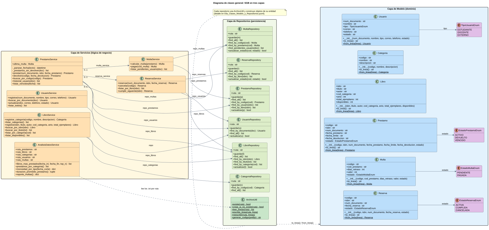

### C.1 Clases: Modelo y Repositorios
Detalle de la persistencia: cada repositorio con ArchivoUtil y su entidad.

- Archivo: `03a_Clases_Modelo_y_Repositorios.puml`
- Imagen local: `img/03a_Clases_Modelo_y_Repositorios.svg` y `img/03a_Clases_Modelo_y_Repositorios.png`
- Ver en línea (SVG): https://www.plantuml.com/plantuml/svg/hLTDRziu4BtxLn3rnK7S8jsasJI7eeuaBmmaZf4uGMy2BT4E6ueKI2gjM-I_xr2V52KdMsSljaW-pinx7Cv8NvN6KcS9GqV7EFGOLaI5Lo8cJ8JRy8QaGb4j91LgeAbc1FaKRoHEC8e9YdBuEOfmYfMPA3QYBMfjL8-KfnWs8VM0O_63yWrQOwQ8jI95ncDFI4uaEhFcOxB66TDJmVKS9mHD9CNCMfz8ANvuWWc9XYSddqvE9zQYYKzDj9PqbMaoYmI_fRy8Eh8WAOuUyORSwYrmaoJIc6-O7HW7IegawDZU9J5_D9EdHuC72hn9akejIaYo8b8DIfledGUw65biDT0e1GnLcl28ueDt29HRt0IBQpISVfoU1P_Hxm4g8WToqGDz4dUQCZJqpe9JhrX5w3SScwRHCpeaFusjaSmqFa3dQ2K4Sn2H95Y6YePSXA-Z6I4oP9GJh6eOWqskMnM1ghI4viWnofyF7AGa5TP6AHUs8N3q46SaOheHerIIDVqkZ7Ub9M2VQrNkL8P1oLhKBHhwNk1xPwKsXyPDlG_66y37M8womkVXcl8uN6t3M4HPGhWM8tWodahB5WepDcefS8WZdM56V-Ns6WcRy3oioGQE6lzvW94JOAa5_1bFjU7TyJLHNDALt4CYTl0Y-IemgbPyP7xCSkwglGwb8cDYf7_g_lrHHQNYrgilwzLt8GaaJR87kVI_aMkhNhbhOx8YKwh4wHfXHfHQebvwQI-zAwXsUwHEiW-tt5SRa9PqTq5ImcCATmQwn4uD6ewXCHRdniQeUEubVGCbLZxjGLlkGxlqzgS7zXgPvsxXB_iXI9HGJaLPxQ-kVJGCZgT_JNshs9V51mqlBlnWUb4nvrdI52fR0YwIbIJsZAQfGIpXhpGMmEvYBH9IajP-JHXP2zwQArZPCs48WUim7BNY6AF2-nWPdsDKM8THQRFMftGboZPnO9bkIlzQYgG451saLOfxAgkhKN6yBuiJvrqeZQZWlVmA6mqn2xy_2xjaExNPvM0ohtsOfeJQCpY3cs5FGCXD9MqX8TTWJBck8jUOXUGxlAOm31VSNekfIWMdAzQUhdKnSPbZDj6CKHw3EM_BCyo2Fy0uNa33nlR-6bRjfTi1Nay3LzITbsbDeWTS5x_k2gC9rQGx7vCdmJ8tgUfh5EGFLRpDRUnaNQ6oSyVQGLNZ8fHgr0JmzZjdjJgd7xskjCc8FlbYYbKeYPPOjLBo2RCycUi9HxFSxGk2sVvCeZLUnYYt_NOvgjRNQLF_Uzx9qkxk52ezxvT1fVctAz8qJgC90MTkiu6-zl4Y2FukfGbkbtV-R39V1ldGl_Q2wZdujWnkvjUshUvjSSnDlENi_hem5TpV1PVBOd0VpBsPtsEhpYB7q2AO-xCwbCNadua_wUwsHEyBP98_UdTNYykPNmucSo-uh8mz3wgU_lxzbuvIvtdl7DJ5p61w53WlJsrGNCG6rN2h8LL-DY2RGWthVa1z-F35_jWSz7t3k1Zt2yDTxtbFTo7kkwwxtdqjT17zLAgNXrqqchRSHw9eE3l2hsjaN-n5nUYFkhexxZvpLZs-pf64GLtYrE0hl7Xd2Hly2m00
- Ver en línea (PNG): https://www.plantuml.com/plantuml/png/hLTDRziu4BtxLn3rnK7S8jsasJI7eeuaBmmaZf4uGMy2BT4E6ueKI2gjM-I_xr2V52KdMsSljaW-pinx7Cv8NvN6KcS9GqV7EFGOLaI5Lo8cJ8JRy8QaGb4j91LgeAbc1FaKRoHEC8e9YdBuEOfmYfMPA3QYBMfjL8-KfnWs8VM0O_63yWrQOwQ8jI95ncDFI4uaEhFcOxB66TDJmVKS9mHD9CNCMfz8ANvuWWc9XYSddqvE9zQYYKzDj9PqbMaoYmI_fRy8Eh8WAOuUyORSwYrmaoJIc6-O7HW7IegawDZU9J5_D9EdHuC72hn9akejIaYo8b8DIfledGUw65biDT0e1GnLcl28ueDt29HRt0IBQpISVfoU1P_Hxm4g8WToqGDz4dUQCZJqpe9JhrX5w3SScwRHCpeaFusjaSmqFa3dQ2K4Sn2H95Y6YePSXA-Z6I4oP9GJh6eOWqskMnM1ghI4viWnofyF7AGa5TP6AHUs8N3q46SaOheHerIIDVqkZ7Ub9M2VQrNkL8P1oLhKBHhwNk1xPwKsXyPDlG_66y37M8womkVXcl8uN6t3M4HPGhWM8tWodahB5WepDcefS8WZdM56V-Ns6WcRy3oioGQE6lzvW94JOAa5_1bFjU7TyJLHNDALt4CYTl0Y-IemgbPyP7xCSkwglGwb8cDYf7_g_lrHHQNYrgilwzLt8GaaJR87kVI_aMkhNhbhOx8YKwh4wHfXHfHQebvwQI-zAwXsUwHEiW-tt5SRa9PqTq5ImcCATmQwn4uD6ewXCHRdniQeUEubVGCbLZxjGLlkGxlqzgS7zXgPvsxXB_iXI9HGJaLPxQ-kVJGCZgT_JNshs9V51mqlBlnWUb4nvrdI52fR0YwIbIJsZAQfGIpXhpGMmEvYBH9IajP-JHXP2zwQArZPCs48WUim7BNY6AF2-nWPdsDKM8THQRFMftGboZPnO9bkIlzQYgG451saLOfxAgkhKN6yBuiJvrqeZQZWlVmA6mqn2xy_2xjaExNPvM0ohtsOfeJQCpY3cs5FGCXD9MqX8TTWJBck8jUOXUGxlAOm31VSNekfIWMdAzQUhdKnSPbZDj6CKHw3EM_BCyo2Fy0uNa33nlR-6bRjfTi1Nay3LzITbsbDeWTS5x_k2gC9rQGx7vCdmJ8tgUfh5EGFLRpDRUnaNQ6oSyVQGLNZ8fHgr0JmzZjdjJgd7xskjCc8FlbYYbKeYPPOjLBo2RCycUi9HxFSxGk2sVvCeZLUnYYt_NOvgjRNQLF_Uzx9qkxk52ezxvT1fVctAz8qJgC90MTkiu6-zl4Y2FukfGbkbtV-R39V1ldGl_Q2wZdujWnkvjUshUvjSSnDlENi_hem5TpV1PVBOd0VpBsPtsEhpYB7q2AO-xCwbCNadua_wUwsHEyBP98_UdTNYykPNmucSo-uh8mz3wgU_lxzbuvIvtdl7DJ5p61w53WlJsrGNCG6rN2h8LL-DY2RGWthVa1z-F35_jWSz7t3k1Zt2yDTxtbFTo7kkwwxtdqjT17zLAgNXrqqchRSHw9eE3l2hsjaN-n5nUYFkhexxZvpLZs-pf64GLtYrE0hl7Xd2Hly2m00
- Editar en línea: https://www.plantuml.com/plantuml/uml/hLTDRziu4BtxLn3rnK7S8jsasJI7eeuaBmmaZf4uGMy2BT4E6ueKI2gjM-I_xr2V52KdMsSljaW-pinx7Cv8NvN6KcS9GqV7EFGOLaI5Lo8cJ8JRy8QaGb4j91LgeAbc1FaKRoHEC8e9YdBuEOfmYfMPA3QYBMfjL8-KfnWs8VM0O_63yWrQOwQ8jI95ncDFI4uaEhFcOxB66TDJmVKS9mHD9CNCMfz8ANvuWWc9XYSddqvE9zQYYKzDj9PqbMaoYmI_fRy8Eh8WAOuUyORSwYrmaoJIc6-O7HW7IegawDZU9J5_D9EdHuC72hn9akejIaYo8b8DIfledGUw65biDT0e1GnLcl28ueDt29HRt0IBQpISVfoU1P_Hxm4g8WToqGDz4dUQCZJqpe9JhrX5w3SScwRHCpeaFusjaSmqFa3dQ2K4Sn2H95Y6YePSXA-Z6I4oP9GJh6eOWqskMnM1ghI4viWnofyF7AGa5TP6AHUs8N3q46SaOheHerIIDVqkZ7Ub9M2VQrNkL8P1oLhKBHhwNk1xPwKsXyPDlG_66y37M8womkVXcl8uN6t3M4HPGhWM8tWodahB5WepDcefS8WZdM56V-Ns6WcRy3oioGQE6lzvW94JOAa5_1bFjU7TyJLHNDALt4CYTl0Y-IemgbPyP7xCSkwglGwb8cDYf7_g_lrHHQNYrgilwzLt8GaaJR87kVI_aMkhNhbhOx8YKwh4wHfXHfHQebvwQI-zAwXsUwHEiW-tt5SRa9PqTq5ImcCATmQwn4uD6ewXCHRdniQeUEubVGCbLZxjGLlkGxlqzgS7zXgPvsxXB_iXI9HGJaLPxQ-kVJGCZgT_JNshs9V51mqlBlnWUb4nvrdI52fR0YwIbIJsZAQfGIpXhpGMmEvYBH9IajP-JHXP2zwQArZPCs48WUim7BNY6AF2-nWPdsDKM8THQRFMftGboZPnO9bkIlzQYgG451saLOfxAgkhKN6yBuiJvrqeZQZWlVmA6mqn2xy_2xjaExNPvM0ohtsOfeJQCpY3cs5FGCXD9MqX8TTWJBck8jUOXUGxlAOm31VSNekfIWMdAzQUhdKnSPbZDj6CKHw3EM_BCyo2Fy0uNa33nlR-6bRjfTi1Nay3LzITbsbDeWTS5x_k2gC9rQGx7vCdmJ8tgUfh5EGFLRpDRUnaNQ6oSyVQGLNZ8fHgr0JmzZjdjJgd7xskjCc8FlbYYbKeYPPOjLBo2RCycUi9HxFSxGk2sVvCeZLUnYYt_NOvgjRNQLF_Uzx9qkxk52ezxvT1fVctAz8qJgC90MTkiu6-zl4Y2FukfGbkbtV-R39V1ldGl_Q2wZdujWnkvjUshUvjSSnDlENi_hem5TpV1PVBOd0VpBsPtsEhpYB7q2AO-xCwbCNadua_wUwsHEyBP98_UdTNYykPNmucSo-uh8mz3wgU_lxzbuvIvtdl7DJ5p61w53WlJsrGNCG6rN2h8LL-DY2RGWthVa1z-F35_jWSz7t3k1Zt2yDTxtbFTo7kkwwxtdqjT17zLAgNXrqqchRSHw9eE3l2hsjaN-n5nUYFkhexxZvpLZs-pf64GLtYrE0hl7Xd2Hly2m00
- Para incrustar:

```markdown
![C.1 Clases: Modelo y Repositorios](https://www.plantuml.com/plantuml/svg/hLTDRziu4BtxLn3rnK7S8jsasJI7eeuaBmmaZf4uGMy2BT4E6ueKI2gjM-I_xr2V52KdMsSljaW-pinx7Cv8NvN6KcS9GqV7EFGOLaI5Lo8cJ8JRy8QaGb4j91LgeAbc1FaKRoHEC8e9YdBuEOfmYfMPA3QYBMfjL8-KfnWs8VM0O_63yWrQOwQ8jI95ncDFI4uaEhFcOxB66TDJmVKS9mHD9CNCMfz8ANvuWWc9XYSddqvE9zQYYKzDj9PqbMaoYmI_fRy8Eh8WAOuUyORSwYrmaoJIc6-O7HW7IegawDZU9J5_D9EdHuC72hn9akejIaYo8b8DIfledGUw65biDT0e1GnLcl28ueDt29HRt0IBQpISVfoU1P_Hxm4g8WToqGDz4dUQCZJqpe9JhrX5w3SScwRHCpeaFusjaSmqFa3dQ2K4Sn2H95Y6YePSXA-Z6I4oP9GJh6eOWqskMnM1ghI4viWnofyF7AGa5TP6AHUs8N3q46SaOheHerIIDVqkZ7Ub9M2VQrNkL8P1oLhKBHhwNk1xPwKsXyPDlG_66y37M8womkVXcl8uN6t3M4HPGhWM8tWodahB5WepDcefS8WZdM56V-Ns6WcRy3oioGQE6lzvW94JOAa5_1bFjU7TyJLHNDALt4CYTl0Y-IemgbPyP7xCSkwglGwb8cDYf7_g_lrHHQNYrgilwzLt8GaaJR87kVI_aMkhNhbhOx8YKwh4wHfXHfHQebvwQI-zAwXsUwHEiW-tt5SRa9PqTq5ImcCATmQwn4uD6ewXCHRdniQeUEubVGCbLZxjGLlkGxlqzgS7zXgPvsxXB_iXI9HGJaLPxQ-kVJGCZgT_JNshs9V51mqlBlnWUb4nvrdI52fR0YwIbIJsZAQfGIpXhpGMmEvYBH9IajP-JHXP2zwQArZPCs48WUim7BNY6AF2-nWPdsDKM8THQRFMftGboZPnO9bkIlzQYgG451saLOfxAgkhKN6yBuiJvrqeZQZWlVmA6mqn2xy_2xjaExNPvM0ohtsOfeJQCpY3cs5FGCXD9MqX8TTWJBck8jUOXUGxlAOm31VSNekfIWMdAzQUhdKnSPbZDj6CKHw3EM_BCyo2Fy0uNa33nlR-6bRjfTi1Nay3LzITbsbDeWTS5x_k2gC9rQGx7vCdmJ8tgUfh5EGFLRpDRUnaNQ6oSyVQGLNZ8fHgr0JmzZjdjJgd7xskjCc8FlbYYbKeYPPOjLBo2RCycUi9HxFSxGk2sVvCeZLUnYYt_NOvgjRNQLF_Uzx9qkxk52ezxvT1fVctAz8qJgC90MTkiu6-zl4Y2FukfGbkbtV-R39V1ldGl_Q2wZdujWnkvjUshUvjSSnDlENi_hem5TpV1PVBOd0VpBsPtsEhpYB7q2AO-xCwbCNadua_wUwsHEyBP98_UdTNYykPNmucSo-uh8mz3wgU_lxzbuvIvtdl7DJ5p61w53WlJsrGNCG6rN2h8LL-DY2RGWthVa1z-F35_jWSz7t3k1Zt2yDTxtbFTo7kkwwxtdqjT17zLAgNXrqqchRSHw9eE3l2hsjaN-n5nUYFkhexxZvpLZs-pf64GLtYrE0hl7Xd2Hly2m00)
```

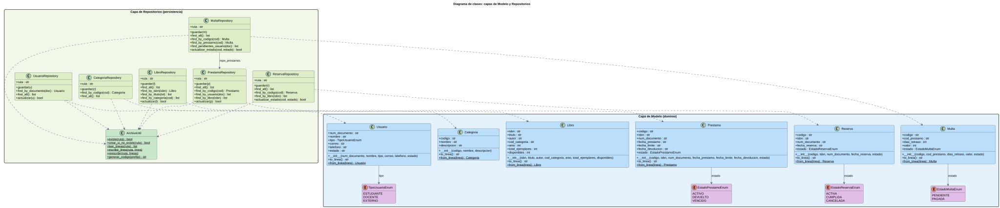

### C.2 Clases: Servicios
Servicios y las dependencias que reciben por constructor.

- Archivo: `03b_Clases_Servicios.puml`
- Imagen local: `img/03b_Clases_Servicios.svg` y `img/03b_Clases_Servicios.png`
- Ver en línea (SVG): https://www.plantuml.com/plantuml/svg/ZLVRRXit47tVho3i5mMn1Rbn3SSFGLHP1WhqOjX8NnSZxcZDcaikIAuI9_1NzHFwOnrokJVjIkwJh9bpXZE7CqFvitLWN5L8jlYmILSIBDhq4SrESA5jueIJo6u5v0OAO1ao7Y0tZ4CPlhTOzi9iPSbKeifGSG4siSz2bK1KPfyWqr-5ojaMfCMUn-XAPIjj51fstRDdk8LAkZkjt1zG85iQ0RBdNngZlwwqr8QTNbx-V7crx3bzbdRfd16Rok6lNAj7yHtPeWSfWJz3Ze_kXIeqo1seNFOJKpf3YoNxq6SPKC_UUBL8dWILZqNfNbY1nGQDJM9CTh8QgJEJ__wJ2nwi2dDDndSd32oxVrm__CLEx-xkhjSNx4V2wkJP5rk14RgEW1wmNlpoKm0mzjvWBgmpO6QgAj9Cywf0vVGPPLri39un9qhwnhKnI9yE9Mwrqk_OJHEuZhEfB0UJbjfqGMRqrmW8t5KWnNSwaTpZo6SCgPMoyGbI-1PBdSwqdNclDv3hjQtqDx4nRzQPSd0a6pN1ZEjCvBrIwPgu4IKfgdpyLGCSdD_I1qaCb1Hsexnmhf8K7IgdZQypwxXaLS8NhHt85F-csvTWqFg8eOgHg3vc27mOKXyuSz_SCB6Ok8SCQfz4PSAMMecDn0CYtnj_FyKXdMdIH05fGPz0zD_zP_2SfzJu5kc8BV8dc3dyvi8bPvGJSR11nVWsjKAb6UwqtA5fMgdBjyQDshRMFXpHXlB49ksQt8PjMg0c17FLtF-GqXEw9aNk6Fb4ENgDPLhL_JjEFegzy-lDjtCuVbBk8E01hJb8Nb7Vr6hF-kLskhyl8OTGQ0tRypRDGRjMa8AqjAUJxZ9we6LcTd1mpeBtwBr4Z8yUWpNrA8uIJ4_PWR_NoD9FG3iFdR1qNYc5eTx9gr1FY-aYTQKi5MqYA-mjE6qF5LIvhfCi1Q8Pxtb28cDpjoL6hgZls16kPs2kWwS5s9X1sokfKAAHSolyjj5bggOcn4_ISFI7g4BJ4IA3BEwGKiSJQ34x30CgUCHcbG4_7PIDBZ0JkXKc17LLAR5fWzBJOqspNfZNv7Nyl3qGt0e_DVw5A-a9fFp2sn_VjeVr_PzqCnVqjdtilMrBmv_4JdznGhBJrVNwQlLn_zrhGx-mqzlL-dPrtIBQ1Ny44rRj4Nyp-aSWOTgE-6DdJY1Uaxt7-_pyqqHTDypBdGoUFu_Spxt6nPOTmwVaY9IkdPFz_U-P4o94Ojk3axn3fRGpCiawNjO-usGndr-S1EB-HKHYtQDl4Xlx3Gk4rDRVZ_7sLgK_BnXQxY3msocEuFz7-BqaUdcDMJ6_ITBRbpL1EdvNa_jtFlyqc6jQLeXCqcAOqqyRHdk5-NMPVAOdY_xVIFu3
- Ver en línea (PNG): https://www.plantuml.com/plantuml/png/ZLVRRXit47tVho3i5mMn1Rbn3SSFGLHP1WhqOjX8NnSZxcZDcaikIAuI9_1NzHFwOnrokJVjIkwJh9bpXZE7CqFvitLWN5L8jlYmILSIBDhq4SrESA5jueIJo6u5v0OAO1ao7Y0tZ4CPlhTOzi9iPSbKeifGSG4siSz2bK1KPfyWqr-5ojaMfCMUn-XAPIjj51fstRDdk8LAkZkjt1zG85iQ0RBdNngZlwwqr8QTNbx-V7crx3bzbdRfd16Rok6lNAj7yHtPeWSfWJz3Ze_kXIeqo1seNFOJKpf3YoNxq6SPKC_UUBL8dWILZqNfNbY1nGQDJM9CTh8QgJEJ__wJ2nwi2dDDndSd32oxVrm__CLEx-xkhjSNx4V2wkJP5rk14RgEW1wmNlpoKm0mzjvWBgmpO6QgAj9Cywf0vVGPPLri39un9qhwnhKnI9yE9Mwrqk_OJHEuZhEfB0UJbjfqGMRqrmW8t5KWnNSwaTpZo6SCgPMoyGbI-1PBdSwqdNclDv3hjQtqDx4nRzQPSd0a6pN1ZEjCvBrIwPgu4IKfgdpyLGCSdD_I1qaCb1Hsexnmhf8K7IgdZQypwxXaLS8NhHt85F-csvTWqFg8eOgHg3vc27mOKXyuSz_SCB6Ok8SCQfz4PSAMMecDn0CYtnj_FyKXdMdIH05fGPz0zD_zP_2SfzJu5kc8BV8dc3dyvi8bPvGJSR11nVWsjKAb6UwqtA5fMgdBjyQDshRMFXpHXlB49ksQt8PjMg0c17FLtF-GqXEw9aNk6Fb4ENgDPLhL_JjEFegzy-lDjtCuVbBk8E01hJb8Nb7Vr6hF-kLskhyl8OTGQ0tRypRDGRjMa8AqjAUJxZ9we6LcTd1mpeBtwBr4Z8yUWpNrA8uIJ4_PWR_NoD9FG3iFdR1qNYc5eTx9gr1FY-aYTQKi5MqYA-mjE6qF5LIvhfCi1Q8Pxtb28cDpjoL6hgZls16kPs2kWwS5s9X1sokfKAAHSolyjj5bggOcn4_ISFI7g4BJ4IA3BEwGKiSJQ34x30CgUCHcbG4_7PIDBZ0JkXKc17LLAR5fWzBJOqspNfZNv7Nyl3qGt0e_DVw5A-a9fFp2sn_VjeVr_PzqCnVqjdtilMrBmv_4JdznGhBJrVNwQlLn_zrhGx-mqzlL-dPrtIBQ1Ny44rRj4Nyp-aSWOTgE-6DdJY1Uaxt7-_pyqqHTDypBdGoUFu_Spxt6nPOTmwVaY9IkdPFz_U-P4o94Ojk3axn3fRGpCiawNjO-usGndr-S1EB-HKHYtQDl4Xlx3Gk4rDRVZ_7sLgK_BnXQxY3msocEuFz7-BqaUdcDMJ6_ITBRbpL1EdvNa_jtFlyqc6jQLeXCqcAOqqyRHdk5-NMPVAOdY_xVIFu3
- Editar en línea: https://www.plantuml.com/plantuml/uml/ZLVRRXit47tVho3i5mMn1Rbn3SSFGLHP1WhqOjX8NnSZxcZDcaikIAuI9_1NzHFwOnrokJVjIkwJh9bpXZE7CqFvitLWN5L8jlYmILSIBDhq4SrESA5jueIJo6u5v0OAO1ao7Y0tZ4CPlhTOzi9iPSbKeifGSG4siSz2bK1KPfyWqr-5ojaMfCMUn-XAPIjj51fstRDdk8LAkZkjt1zG85iQ0RBdNngZlwwqr8QTNbx-V7crx3bzbdRfd16Rok6lNAj7yHtPeWSfWJz3Ze_kXIeqo1seNFOJKpf3YoNxq6SPKC_UUBL8dWILZqNfNbY1nGQDJM9CTh8QgJEJ__wJ2nwi2dDDndSd32oxVrm__CLEx-xkhjSNx4V2wkJP5rk14RgEW1wmNlpoKm0mzjvWBgmpO6QgAj9Cywf0vVGPPLri39un9qhwnhKnI9yE9Mwrqk_OJHEuZhEfB0UJbjfqGMRqrmW8t5KWnNSwaTpZo6SCgPMoyGbI-1PBdSwqdNclDv3hjQtqDx4nRzQPSd0a6pN1ZEjCvBrIwPgu4IKfgdpyLGCSdD_I1qaCb1Hsexnmhf8K7IgdZQypwxXaLS8NhHt85F-csvTWqFg8eOgHg3vc27mOKXyuSz_SCB6Ok8SCQfz4PSAMMecDn0CYtnj_FyKXdMdIH05fGPz0zD_zP_2SfzJu5kc8BV8dc3dyvi8bPvGJSR11nVWsjKAb6UwqtA5fMgdBjyQDshRMFXpHXlB49ksQt8PjMg0c17FLtF-GqXEw9aNk6Fb4ENgDPLhL_JjEFegzy-lDjtCuVbBk8E01hJb8Nb7Vr6hF-kLskhyl8OTGQ0tRypRDGRjMa8AqjAUJxZ9we6LcTd1mpeBtwBr4Z8yUWpNrA8uIJ4_PWR_NoD9FG3iFdR1qNYc5eTx9gr1FY-aYTQKi5MqYA-mjE6qF5LIvhfCi1Q8Pxtb28cDpjoL6hgZls16kPs2kWwS5s9X1sokfKAAHSolyjj5bggOcn4_ISFI7g4BJ4IA3BEwGKiSJQ34x30CgUCHcbG4_7PIDBZ0JkXKc17LLAR5fWzBJOqspNfZNv7Nyl3qGt0e_DVw5A-a9fFp2sn_VjeVr_PzqCnVqjdtilMrBmv_4JdznGhBJrVNwQlLn_zrhGx-mqzlL-dPrtIBQ1Ny44rRj4Nyp-aSWOTgE-6DdJY1Uaxt7-_pyqqHTDypBdGoUFu_Spxt6nPOTmwVaY9IkdPFz_U-P4o94Ojk3axn3fRGpCiawNjO-usGndr-S1EB-HKHYtQDl4Xlx3Gk4rDRVZ_7sLgK_BnXQxY3msocEuFz7-BqaUdcDMJ6_ITBRbpL1EdvNa_jtFlyqc6jQLeXCqcAOqqyRHdk5-NMPVAOdY_xVIFu3
- Para incrustar:

```markdown
![C.2 Clases: Servicios](https://www.plantuml.com/plantuml/svg/ZLVRRXit47tVho3i5mMn1Rbn3SSFGLHP1WhqOjX8NnSZxcZDcaikIAuI9_1NzHFwOnrokJVjIkwJh9bpXZE7CqFvitLWN5L8jlYmILSIBDhq4SrESA5jueIJo6u5v0OAO1ao7Y0tZ4CPlhTOzi9iPSbKeifGSG4siSz2bK1KPfyWqr-5ojaMfCMUn-XAPIjj51fstRDdk8LAkZkjt1zG85iQ0RBdNngZlwwqr8QTNbx-V7crx3bzbdRfd16Rok6lNAj7yHtPeWSfWJz3Ze_kXIeqo1seNFOJKpf3YoNxq6SPKC_UUBL8dWILZqNfNbY1nGQDJM9CTh8QgJEJ__wJ2nwi2dDDndSd32oxVrm__CLEx-xkhjSNx4V2wkJP5rk14RgEW1wmNlpoKm0mzjvWBgmpO6QgAj9Cywf0vVGPPLri39un9qhwnhKnI9yE9Mwrqk_OJHEuZhEfB0UJbjfqGMRqrmW8t5KWnNSwaTpZo6SCgPMoyGbI-1PBdSwqdNclDv3hjQtqDx4nRzQPSd0a6pN1ZEjCvBrIwPgu4IKfgdpyLGCSdD_I1qaCb1Hsexnmhf8K7IgdZQypwxXaLS8NhHt85F-csvTWqFg8eOgHg3vc27mOKXyuSz_SCB6Ok8SCQfz4PSAMMecDn0CYtnj_FyKXdMdIH05fGPz0zD_zP_2SfzJu5kc8BV8dc3dyvi8bPvGJSR11nVWsjKAb6UwqtA5fMgdBjyQDshRMFXpHXlB49ksQt8PjMg0c17FLtF-GqXEw9aNk6Fb4ENgDPLhL_JjEFegzy-lDjtCuVbBk8E01hJb8Nb7Vr6hF-kLskhyl8OTGQ0tRypRDGRjMa8AqjAUJxZ9we6LcTd1mpeBtwBr4Z8yUWpNrA8uIJ4_PWR_NoD9FG3iFdR1qNYc5eTx9gr1FY-aYTQKi5MqYA-mjE6qF5LIvhfCi1Q8Pxtb28cDpjoL6hgZls16kPs2kWwS5s9X1sokfKAAHSolyjj5bggOcn4_ISFI7g4BJ4IA3BEwGKiSJQ34x30CgUCHcbG4_7PIDBZ0JkXKc17LLAR5fWzBJOqspNfZNv7Nyl3qGt0e_DVw5A-a9fFp2sn_VjeVr_PzqCnVqjdtilMrBmv_4JdznGhBJrVNwQlLn_zrhGx-mqzlL-dPrtIBQ1Ny44rRj4Nyp-aSWOTgE-6DdJY1Uaxt7-_pyqqHTDypBdGoUFu_Spxt6nPOTmwVaY9IkdPFz_U-P4o94Ojk3axn3fRGpCiawNjO-usGndr-S1EB-HKHYtQDl4Xlx3Gk4rDRVZ_7sLgK_BnXQxY3msocEuFz7-BqaUdcDMJ6_ITBRbpL1EdvNa_jtFlyqc6jQLeXCqcAOqqyRHdk5-NMPVAOdY_xVIFu3)
```

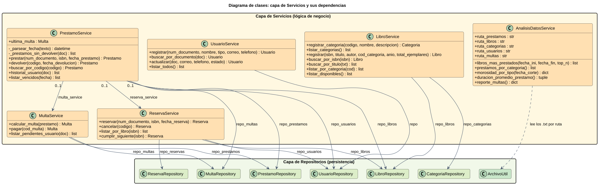

### C.3 Arquitectura de capas
Vista de alto nivel: interfaz, servicios, repositorios, modelo y archivos .txt.

- Archivo: `03c_Arquitectura_Capas.puml`
- Imagen local: `img/03c_Arquitectura_Capas.svg` y `img/03c_Arquitectura_Capas.png`
- Ver en línea (SVG): https://www.plantuml.com/plantuml/svg/TPJ1RXen48Rl-nGZSW69qAJGDEsX2W4sGYeL0j4J4Xgy0rZnsblRIqBQFbLllUR5EbwMpQfDRvv_x9blncFVE8_Mvwc2YwvOzUstN7eIFhUu6c26BlBIAuAw0n82Ryc121lOKZ2_kutSlTGPMap1xJ0n3r9lOOFAKSrZJQwJWR6QB5pNz8Gsc2iV6-s_O1hIILGrVzzQyp0mobWuw_NUzQxwDQTGw5pVUolNkQUnC7ekdmWkQbio5FUufRa_S2sMoq2zLNKmRH9ob46tVigYlW_YrKMqarmqfPa_G4hfcgoB56qyU0DMRdSU4Xd2IgEZCXSqnjgJtU1Jw5VkShJIG5EGIhXflSvZgm5dey4eZY_XUmGWJ9ePJTf38oMThp8hjP0PggKkx3A2AqqbrxOoChuDZsbbiqbsZswLSbFnfA969Prq3M20nJZw-O8QhZfWplcO59o5sU8ulXxzmxOuOXmtqb9_3XoLDIr1Ac4I02fhTkIgx7v9D4HlNAaMTFElhz7DA3DEUcDBm4i6_F0tOD-AdToRXPVSkPAsEdXOwW5wsd88h8j55NNXL4XTAsgf2sKvBrB1Ffk-nZxX0LCcN7atVXiF_zFMDbHuRIYWNb3QK02qeKoxr2ETfsIHxqlJyLOdGywTeCSrEgfwuQ3Z7psGXZjZUEvXQEMUszyKo00EUCPvtXDUPVp0VhIAKCFRQ366y_DFV1dm4QJU6u4HhuCqcxB43yq58ZZ0bkaJZ5WEticGlTxmZ6h2PWlUmCQQz6IUTWrlUPSYukFa13zU2j4xdVAyi1GYfoQH6ycPjV44Q-EzIS5imeG0l3O_HKXrglduBFbBuRV81r9A9F8IQbC2JKVRvzyQ-1-R3kCsjqC8-VnBm_jEjzM9I2SGaaStlEAFCle3
- Ver en línea (PNG): https://www.plantuml.com/plantuml/png/TPJ1RXen48Rl-nGZSW69qAJGDEsX2W4sGYeL0j4J4Xgy0rZnsblRIqBQFbLllUR5EbwMpQfDRvv_x9blncFVE8_Mvwc2YwvOzUstN7eIFhUu6c26BlBIAuAw0n82Ryc121lOKZ2_kutSlTGPMap1xJ0n3r9lOOFAKSrZJQwJWR6QB5pNz8Gsc2iV6-s_O1hIILGrVzzQyp0mobWuw_NUzQxwDQTGw5pVUolNkQUnC7ekdmWkQbio5FUufRa_S2sMoq2zLNKmRH9ob46tVigYlW_YrKMqarmqfPa_G4hfcgoB56qyU0DMRdSU4Xd2IgEZCXSqnjgJtU1Jw5VkShJIG5EGIhXflSvZgm5dey4eZY_XUmGWJ9ePJTf38oMThp8hjP0PggKkx3A2AqqbrxOoChuDZsbbiqbsZswLSbFnfA969Prq3M20nJZw-O8QhZfWplcO59o5sU8ulXxzmxOuOXmtqb9_3XoLDIr1Ac4I02fhTkIgx7v9D4HlNAaMTFElhz7DA3DEUcDBm4i6_F0tOD-AdToRXPVSkPAsEdXOwW5wsd88h8j55NNXL4XTAsgf2sKvBrB1Ffk-nZxX0LCcN7atVXiF_zFMDbHuRIYWNb3QK02qeKoxr2ETfsIHxqlJyLOdGywTeCSrEgfwuQ3Z7psGXZjZUEvXQEMUszyKo00EUCPvtXDUPVp0VhIAKCFRQ366y_DFV1dm4QJU6u4HhuCqcxB43yq58ZZ0bkaJZ5WEticGlTxmZ6h2PWlUmCQQz6IUTWrlUPSYukFa13zU2j4xdVAyi1GYfoQH6ycPjV44Q-EzIS5imeG0l3O_HKXrglduBFbBuRV81r9A9F8IQbC2JKVRvzyQ-1-R3kCsjqC8-VnBm_jEjzM9I2SGaaStlEAFCle3
- Editar en línea: https://www.plantuml.com/plantuml/uml/TPJ1RXen48Rl-nGZSW69qAJGDEsX2W4sGYeL0j4J4Xgy0rZnsblRIqBQFbLllUR5EbwMpQfDRvv_x9blncFVE8_Mvwc2YwvOzUstN7eIFhUu6c26BlBIAuAw0n82Ryc121lOKZ2_kutSlTGPMap1xJ0n3r9lOOFAKSrZJQwJWR6QB5pNz8Gsc2iV6-s_O1hIILGrVzzQyp0mobWuw_NUzQxwDQTGw5pVUolNkQUnC7ekdmWkQbio5FUufRa_S2sMoq2zLNKmRH9ob46tVigYlW_YrKMqarmqfPa_G4hfcgoB56qyU0DMRdSU4Xd2IgEZCXSqnjgJtU1Jw5VkShJIG5EGIhXflSvZgm5dey4eZY_XUmGWJ9ePJTf38oMThp8hjP0PggKkx3A2AqqbrxOoChuDZsbbiqbsZswLSbFnfA969Prq3M20nJZw-O8QhZfWplcO59o5sU8ulXxzmxOuOXmtqb9_3XoLDIr1Ac4I02fhTkIgx7v9D4HlNAaMTFElhz7DA3DEUcDBm4i6_F0tOD-AdToRXPVSkPAsEdXOwW5wsd88h8j55NNXL4XTAsgf2sKvBrB1Ffk-nZxX0LCcN7atVXiF_zFMDbHuRIYWNb3QK02qeKoxr2ETfsIHxqlJyLOdGywTeCSrEgfwuQ3Z7psGXZjZUEvXQEMUszyKo00EUCPvtXDUPVp0VhIAKCFRQ366y_DFV1dm4QJU6u4HhuCqcxB43yq58ZZ0bkaJZ5WEticGlTxmZ6h2PWlUmCQQz6IUTWrlUPSYukFa13zU2j4xdVAyi1GYfoQH6ycPjV44Q-EzIS5imeG0l3O_HKXrglduBFbBuRV81r9A9F8IQbC2JKVRvzyQ-1-R3kCsjqC8-VnBm_jEjzM9I2SGaaStlEAFCle3
- Para incrustar:

```markdown

```

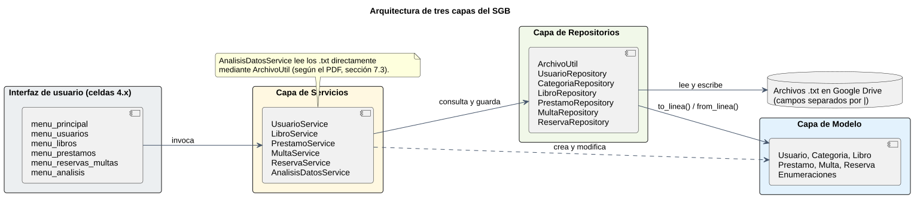

### D. Diagrama de objetos
Instancias reales de los datos de prueba: María, Carlos y Juan, dos libros, préstamos, multas y una reserva.

- Archivo: `04_Diagrama_Objetos.puml`
- Imagen local: `img/04_Diagrama_Objetos.svg` y `img/04_Diagrama_Objetos.png`
- Ver en línea (SVG): https://www.plantuml.com/plantuml/svg/dLVDRkCs4BxhAGZtidlmGb8i9p5GO5rP2R9m4YDn5hq9jCGup5AYIb9PP8i-K0zzYdsn3ga_ofRjeWQ2o3F3cU_ZV1pHdwN2GfKPG-uaNb2y5JZ3yVtcbIWk7KKL8wWnevGWNdbcACNmJriAKPADyILORB68ZIUkp1y-El8RpGiCwv5ymId_JlCjUiPC4iiZU9cd8HSv4UZ2igVa6PTCNV5StU6CeBcWc5d-kH3yUyWP5-YNoIIOJEUMKqDD5FhJGUWtd7pRraLCS7HsvLyjj8UBb8ZQwWNJ87ITlnp52wGusd2bEA2W0X9HdZjEdNEql5cZ6Ggn8biEc4O8Iw2lOaQhWWbFwPQZNqta20mvppQ260DLH61L2gpjAP69e4K2sRNpZhyH1hdUKLAI7FPn16YQekie72ogIB9J52BxHTSaoO7ZbWuLNGbk-ck-loD9fI8PxfLcT2DuI4aE09RwsHGtrZZHPbsVoet9Ttb-SHbS1Axh-MSJNGzaL383pAJ0EQsa8paZAKvr22uLT00Yhl56KCBGDHO9nUWMYpzAycDKqOkJXhorjJeTVFKkf-Uw5bUOnUILP0N3WaZm19eobGNFwOOPozakjKWgKIQwANA08P5gWE3vD9YS-LwVe9q865Qd13YltjKBptjCvpb6rpmxGAvkOKtETtrtc9o_Hywro6LOfvkX9rd2KyMfica-UPd5AK_AJ4jD5_NSovfMNpwtPicI5nLOHGiT7ZskdnOtyxjr13RO8pZTXbUullbwRwi71WFZSWT6RJo08wW_VHnXjUQXf3qSlw-ZXxlx4o1UIvplG32c0m2CU8FfUH_05xrYHKHl7nRtONHw4mf1Rkjkh8GEp2eGO8-xbdHdUFKGZQ7j0K09t4iNFgDZP-n4Bvz9ye9XA5U5jL_d7dlks0qwFwCPJ2VRwrchK_B6MTbCZJR2h6-PBwAlJz5oVTzd7ZOAsADkoM28knUu5sV_WxkjdyFSlQFSVVSKT_-_SFzI2M-FUQk-GTw-vmttt1ex9sHxXBT_bFVv0TvvoPZDjnAvFMvArcZy5jxRrIiAZ8C2ltrQjats_8Qi7eGsvE5Za58iOq4KZ5bkvZb2RvYPkQhLOeDSpQ_dYtaVP2l7Fif1BNOmuMzo6gQjs1sOWGKps8KPtIrkp1Zfa4B-PZiVY2JYhO8Avi4DVOWU6mpJGnFZk7hs9uQewlR4CntjYK3lhzDSWCPZ-sOmGt1xB0liD5ULrgrVgwst8WI-RXxEz0M19bJfjQOpjRjzdxH-SvPgRpteMr-NS1UOv33M7IlZuO2cW8syyxRfEwtFq9R0THRlfBTaraQqgxl6pj0BJeZJ6GPBEpc7aolezaKX_cpbXluOPQE2v2bGKMI6Dep3JGgBd_zWQ3qSQnrLY9z_6msRsqfzB3uqe-eHMayJygaIklZuoO5qI1TrFiCJ_6fm_WK0
- Ver en línea (PNG): https://www.plantuml.com/plantuml/png/dLVDRkCs4BxhAGZtidlmGb8i9p5GO5rP2R9m4YDn5hq9jCGup5AYIb9PP8i-K0zzYdsn3ga_ofRjeWQ2o3F3cU_ZV1pHdwN2GfKPG-uaNb2y5JZ3yVtcbIWk7KKL8wWnevGWNdbcACNmJriAKPADyILORB68ZIUkp1y-El8RpGiCwv5ymId_JlCjUiPC4iiZU9cd8HSv4UZ2igVa6PTCNV5StU6CeBcWc5d-kH3yUyWP5-YNoIIOJEUMKqDD5FhJGUWtd7pRraLCS7HsvLyjj8UBb8ZQwWNJ87ITlnp52wGusd2bEA2W0X9HdZjEdNEql5cZ6Ggn8biEc4O8Iw2lOaQhWWbFwPQZNqta20mvppQ260DLH61L2gpjAP69e4K2sRNpZhyH1hdUKLAI7FPn16YQekie72ogIB9J52BxHTSaoO7ZbWuLNGbk-ck-loD9fI8PxfLcT2DuI4aE09RwsHGtrZZHPbsVoet9Ttb-SHbS1Axh-MSJNGzaL383pAJ0EQsa8paZAKvr22uLT00Yhl56KCBGDHO9nUWMYpzAycDKqOkJXhorjJeTVFKkf-Uw5bUOnUILP0N3WaZm19eobGNFwOOPozakjKWgKIQwANA08P5gWE3vD9YS-LwVe9q865Qd13YltjKBptjCvpb6rpmxGAvkOKtETtrtc9o_Hywro6LOfvkX9rd2KyMfica-UPd5AK_AJ4jD5_NSovfMNpwtPicI5nLOHGiT7ZskdnOtyxjr13RO8pZTXbUullbwRwi71WFZSWT6RJo08wW_VHnXjUQXf3qSlw-ZXxlx4o1UIvplG32c0m2CU8FfUH_05xrYHKHl7nRtONHw4mf1Rkjkh8GEp2eGO8-xbdHdUFKGZQ7j0K09t4iNFgDZP-n4Bvz9ye9XA5U5jL_d7dlks0qwFwCPJ2VRwrchK_B6MTbCZJR2h6-PBwAlJz5oVTzd7ZOAsADkoM28knUu5sV_WxkjdyFSlQFSVVSKT_-_SFzI2M-FUQk-GTw-vmttt1ex9sHxXBT_bFVv0TvvoPZDjnAvFMvArcZy5jxRrIiAZ8C2ltrQjats_8Qi7eGsvE5Za58iOq4KZ5bkvZb2RvYPkQhLOeDSpQ_dYtaVP2l7Fif1BNOmuMzo6gQjs1sOWGKps8KPtIrkp1Zfa4B-PZiVY2JYhO8Avi4DVOWU6mpJGnFZk7hs9uQewlR4CntjYK3lhzDSWCPZ-sOmGt1xB0liD5ULrgrVgwst8WI-RXxEz0M19bJfjQOpjRjzdxH-SvPgRpteMr-NS1UOv33M7IlZuO2cW8syyxRfEwtFq9R0THRlfBTaraQqgxl6pj0BJeZJ6GPBEpc7aolezaKX_cpbXluOPQE2v2bGKMI6Dep3JGgBd_zWQ3qSQnrLY9z_6msRsqfzB3uqe-eHMayJygaIklZuoO5qI1TrFiCJ_6fm_WK0
- Editar en línea: https://www.plantuml.com/plantuml/uml/dLVDRkCs4BxhAGZtidlmGb8i9p5GO5rP2R9m4YDn5hq9jCGup5AYIb9PP8i-K0zzYdsn3ga_ofRjeWQ2o3F3cU_ZV1pHdwN2GfKPG-uaNb2y5JZ3yVtcbIWk7KKL8wWnevGWNdbcACNmJriAKPADyILORB68ZIUkp1y-El8RpGiCwv5ymId_JlCjUiPC4iiZU9cd8HSv4UZ2igVa6PTCNV5StU6CeBcWc5d-kH3yUyWP5-YNoIIOJEUMKqDD5FhJGUWtd7pRraLCS7HsvLyjj8UBb8ZQwWNJ87ITlnp52wGusd2bEA2W0X9HdZjEdNEql5cZ6Ggn8biEc4O8Iw2lOaQhWWbFwPQZNqta20mvppQ260DLH61L2gpjAP69e4K2sRNpZhyH1hdUKLAI7FPn16YQekie72ogIB9J52BxHTSaoO7ZbWuLNGbk-ck-loD9fI8PxfLcT2DuI4aE09RwsHGtrZZHPbsVoet9Ttb-SHbS1Axh-MSJNGzaL383pAJ0EQsa8paZAKvr22uLT00Yhl56KCBGDHO9nUWMYpzAycDKqOkJXhorjJeTVFKkf-Uw5bUOnUILP0N3WaZm19eobGNFwOOPozakjKWgKIQwANA08P5gWE3vD9YS-LwVe9q865Qd13YltjKBptjCvpb6rpmxGAvkOKtETtrtc9o_Hywro6LOfvkX9rd2KyMfica-UPd5AK_AJ4jD5_NSovfMNpwtPicI5nLOHGiT7ZskdnOtyxjr13RO8pZTXbUullbwRwi71WFZSWT6RJo08wW_VHnXjUQXf3qSlw-ZXxlx4o1UIvplG32c0m2CU8FfUH_05xrYHKHl7nRtONHw4mf1Rkjkh8GEp2eGO8-xbdHdUFKGZQ7j0K09t4iNFgDZP-n4Bvz9ye9XA5U5jL_d7dlks0qwFwCPJ2VRwrchK_B6MTbCZJR2h6-PBwAlJz5oVTzd7ZOAsADkoM28knUu5sV_WxkjdyFSlQFSVVSKT_-_SFzI2M-FUQk-GTw-vmttt1ex9sHxXBT_bFVv0TvvoPZDjnAvFMvArcZy5jxRrIiAZ8C2ltrQjats_8Qi7eGsvE5Za58iOq4KZ5bkvZb2RvYPkQhLOeDSpQ_dYtaVP2l7Fif1BNOmuMzo6gQjs1sOWGKps8KPtIrkp1Zfa4B-PZiVY2JYhO8Avi4DVOWU6mpJGnFZk7hs9uQewlR4CntjYK3lhzDSWCPZ-sOmGt1xB0liD5ULrgrVgwst8WI-RXxEz0M19bJfjQOpjRjzdxH-SvPgRpteMr-NS1UOv33M7IlZuO2cW8syyxRfEwtFq9R0THRlfBTaraQqgxl6pj0BJeZJ6GPBEpc7aolezaKX_cpbXluOPQE2v2bGKMI6Dep3JGgBd_zWQ3qSQnrLY9z_6msRsqfzB3uqe-eHMayJygaIklZuoO5qI1TrFiCJ_6fm_WK0
- Para incrustar:

```markdown
![D. Diagrama de objetos](https://www.plantuml.com/plantuml/svg/dLVDRkCs4BxhAGZtidlmGb8i9p5GO5rP2R9m4YDn5hq9jCGup5AYIb9PP8i-K0zzYdsn3ga_ofRjeWQ2o3F3cU_ZV1pHdwN2GfKPG-uaNb2y5JZ3yVtcbIWk7KKL8wWnevGWNdbcACNmJriAKPADyILORB68ZIUkp1y-El8RpGiCwv5ymId_JlCjUiPC4iiZU9cd8HSv4UZ2igVa6PTCNV5StU6CeBcWc5d-kH3yUyWP5-YNoIIOJEUMKqDD5FhJGUWtd7pRraLCS7HsvLyjj8UBb8ZQwWNJ87ITlnp52wGusd2bEA2W0X9HdZjEdNEql5cZ6Ggn8biEc4O8Iw2lOaQhWWbFwPQZNqta20mvppQ260DLH61L2gpjAP69e4K2sRNpZhyH1hdUKLAI7FPn16YQekie72ogIB9J52BxHTSaoO7ZbWuLNGbk-ck-loD9fI8PxfLcT2DuI4aE09RwsHGtrZZHPbsVoet9Ttb-SHbS1Axh-MSJNGzaL383pAJ0EQsa8paZAKvr22uLT00Yhl56KCBGDHO9nUWMYpzAycDKqOkJXhorjJeTVFKkf-Uw5bUOnUILP0N3WaZm19eobGNFwOOPozakjKWgKIQwANA08P5gWE3vD9YS-LwVe9q865Qd13YltjKBptjCvpb6rpmxGAvkOKtETtrtc9o_Hywro6LOfvkX9rd2KyMfica-UPd5AK_AJ4jD5_NSovfMNpwtPicI5nLOHGiT7ZskdnOtyxjr13RO8pZTXbUullbwRwi71WFZSWT6RJo08wW_VHnXjUQXf3qSlw-ZXxlx4o1UIvplG32c0m2CU8FfUH_05xrYHKHl7nRtONHw4mf1Rkjkh8GEp2eGO8-xbdHdUFKGZQ7j0K09t4iNFgDZP-n4Bvz9ye9XA5U5jL_d7dlks0qwFwCPJ2VRwrchK_B6MTbCZJR2h6-PBwAlJz5oVTzd7ZOAsADkoM28knUu5sV_WxkjdyFSlQFSVVSKT_-_SFzI2M-FUQk-GTw-vmttt1ex9sHxXBT_bFVv0TvvoPZDjnAvFMvArcZy5jxRrIiAZ8C2ltrQjats_8Qi7eGsvE5Za58iOq4KZ5bkvZb2RvYPkQhLOeDSpQ_dYtaVP2l7Fif1BNOmuMzo6gQjs1sOWGKps8KPtIrkp1Zfa4B-PZiVY2JYhO8Avi4DVOWU6mpJGnFZk7hs9uQewlR4CntjYK3lhzDSWCPZ-sOmGt1xB0liD5ULrgrVgwst8WI-RXxEz0M19bJfjQOpjRjzdxH-SvPgRpteMr-NS1UOv33M7IlZuO2cW8syyxRfEwtFq9R0THRlfBTaraQqgxl6pj0BJeZJ6GPBEpc7aolezaKX_cpbXluOPQE2v2bGKMI6Dep3JGgBd_zWQ3qSQnrLY9z_6msRsqfzB3uqe-eHMayJygaIklZuoO5qI1TrFiCJ_6fm_WK0)
```

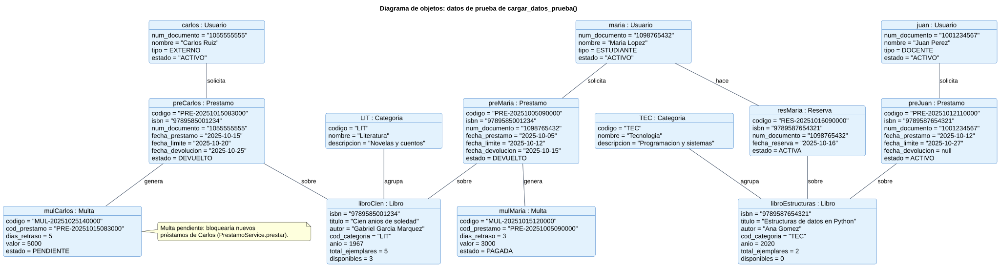

### E.1 Actividad: registro de usuario
Validaciones de UsuarioService.registrar.

- Archivo: `05_Diagramas_Comportamiento/01_Registro_Usuario.puml`
- Imagen local: `img/01_Registro_Usuario.svg` y `img/01_Registro_Usuario.png`
- Ver en línea (SVG): https://www.plantuml.com/plantuml/svg/jPNFJjj04CRlVeeHlTWIZGWGIisXf4aizK9L2aYLaAADTnnMsBlM_Z54LT-YXnvwwR67l02NIisRz4aw6nnZMf1GezwitTdFlvdvPlVGMAQjAtBOwewFSIgCrMfyQXpJGWLMs1oXdrfH2Svu3BgE08xW9BZRE0Zh0-zHLoB5JXt6T1IOIo5Bfba1ve9nTINa53AM6spjSCoOossYf3rY1VrG2vQtzljQgwk1ofM6PxkxlTszVckJBUdi33u60AzPUZdLoabUXuzsakraw7UKvgZhrMvlhpVOejMXO8MI_AzZIPBiZxgjWFRfv6L_VxiNV6f1I6NnOG1I6evU-61Vw20kKBfnNJSJGuweWQlKqRfLcoHKJ3HkdaihIgfhz_bEj0cfqXeLpC1YllYUAQaEWlYT4wG8Q4gMaXI4L71HHi0WPPm1PvQYH0RXpn_3bJuOWY8v2NmndmghpAi8x0LA2AMA29zm1yFXTdp6SeSZAhk6ZL5-1qYjcg0Ni2W9V2ad5pS5QcKs3aWWfcYANDn0uT1R07vz_KBabSEyGc3rhWyrLfK1IYwo6lDecJkL02gMBkRgQMooELKw95kYBtIji3RIYUy26kzr_rdRV2HTyJIuPHVzhDI38fTgrU9RBlZwT8DRN_X-PaeNrF6LzDFeQbyHb1NKJv_b7phh5t3bs7-rNcFv_sIzkExfCPRA49QUTJ8X-NWo6pUk3vklQ3LI7nZWDTrnzwv1dnqQl1kN9aMpc3-Mu-DAhRbR9y61HXg8qtkCbgvYw0zEtfozFNYe15DQu4o7DKzqBiE-JYz4fKwjo3jeKYqcGezp8P7u6t3JiTUMYlGGwkU6OVKySBgXbgI7X4flKF0R
- Ver en línea (PNG): https://www.plantuml.com/plantuml/png/jPNFJjj04CRlVeeHlTWIZGWGIisXf4aizK9L2aYLaAADTnnMsBlM_Z54LT-YXnvwwR67l02NIisRz4aw6nnZMf1GezwitTdFlvdvPlVGMAQjAtBOwewFSIgCrMfyQXpJGWLMs1oXdrfH2Svu3BgE08xW9BZRE0Zh0-zHLoB5JXt6T1IOIo5Bfba1ve9nTINa53AM6spjSCoOossYf3rY1VrG2vQtzljQgwk1ofM6PxkxlTszVckJBUdi33u60AzPUZdLoabUXuzsakraw7UKvgZhrMvlhpVOejMXO8MI_AzZIPBiZxgjWFRfv6L_VxiNV6f1I6NnOG1I6evU-61Vw20kKBfnNJSJGuweWQlKqRfLcoHKJ3HkdaihIgfhz_bEj0cfqXeLpC1YllYUAQaEWlYT4wG8Q4gMaXI4L71HHi0WPPm1PvQYH0RXpn_3bJuOWY8v2NmndmghpAi8x0LA2AMA29zm1yFXTdp6SeSZAhk6ZL5-1qYjcg0Ni2W9V2ad5pS5QcKs3aWWfcYANDn0uT1R07vz_KBabSEyGc3rhWyrLfK1IYwo6lDecJkL02gMBkRgQMooELKw95kYBtIji3RIYUy26kzr_rdRV2HTyJIuPHVzhDI38fTgrU9RBlZwT8DRN_X-PaeNrF6LzDFeQbyHb1NKJv_b7phh5t3bs7-rNcFv_sIzkExfCPRA49QUTJ8X-NWo6pUk3vklQ3LI7nZWDTrnzwv1dnqQl1kN9aMpc3-Mu-DAhRbR9y61HXg8qtkCbgvYw0zEtfozFNYe15DQu4o7DKzqBiE-JYz4fKwjo3jeKYqcGezp8P7u6t3JiTUMYlGGwkU6OVKySBgXbgI7X4flKF0R
- Editar en línea: https://www.plantuml.com/plantuml/uml/jPNFJjj04CRlVeeHlTWIZGWGIisXf4aizK9L2aYLaAADTnnMsBlM_Z54LT-YXnvwwR67l02NIisRz4aw6nnZMf1GezwitTdFlvdvPlVGMAQjAtBOwewFSIgCrMfyQXpJGWLMs1oXdrfH2Svu3BgE08xW9BZRE0Zh0-zHLoB5JXt6T1IOIo5Bfba1ve9nTINa53AM6spjSCoOossYf3rY1VrG2vQtzljQgwk1ofM6PxkxlTszVckJBUdi33u60AzPUZdLoabUXuzsakraw7UKvgZhrMvlhpVOejMXO8MI_AzZIPBiZxgjWFRfv6L_VxiNV6f1I6NnOG1I6evU-61Vw20kKBfnNJSJGuweWQlKqRfLcoHKJ3HkdaihIgfhz_bEj0cfqXeLpC1YllYUAQaEWlYT4wG8Q4gMaXI4L71HHi0WPPm1PvQYH0RXpn_3bJuOWY8v2NmndmghpAi8x0LA2AMA29zm1yFXTdp6SeSZAhk6ZL5-1qYjcg0Ni2W9V2ad5pS5QcKs3aWWfcYANDn0uT1R07vz_KBabSEyGc3rhWyrLfK1IYwo6lDecJkL02gMBkRgQMooELKw95kYBtIji3RIYUy26kzr_rdRV2HTyJIuPHVzhDI38fTgrU9RBlZwT8DRN_X-PaeNrF6LzDFeQbyHb1NKJv_b7phh5t3bs7-rNcFv_sIzkExfCPRA49QUTJ8X-NWo6pUk3vklQ3LI7nZWDTrnzwv1dnqQl1kN9aMpc3-Mu-DAhRbR9y61HXg8qtkCbgvYw0zEtfozFNYe15DQu4o7DKzqBiE-JYz4fKwjo3jeKYqcGezp8P7u6t3JiTUMYlGGwkU6OVKySBgXbgI7X4flKF0R
- Para incrustar:

```markdown

```

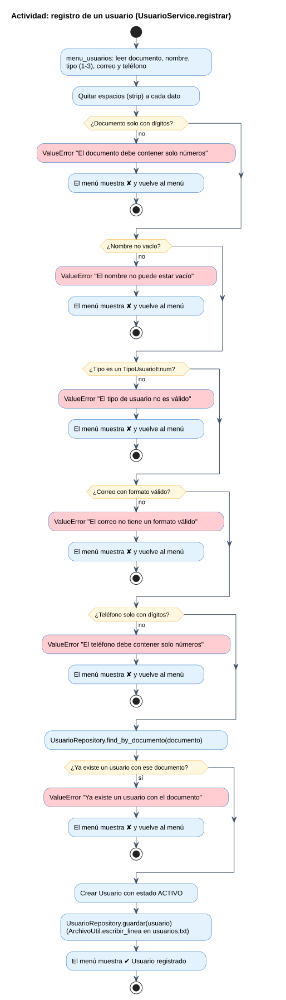

### E.2 Actividad: registro de categoría y libro
Flujo de LibroService.registrar_categoria y registrar.

- Archivo: `05_Diagramas_Comportamiento/02_Registro_Libro.puml`
- Imagen local: `img/02_Registro_Libro.svg` y `img/02_Registro_Libro.png`
- Ver en línea (SVG): https://www.plantuml.com/plantuml/svg/pLNDQjj04BxxAGRt8eC9jXktgKtQEFw1WiaXWKAXOCRQjRFDQbVihfoQahVeeOTU-W0-bDnoALHlqYVfh2JRCdKW2JqKZ2NczvlvPaOdrg5nIIIXqPgSyxcmpkZ9M4oDhZZX98TUwCH2C6GTC8KU68T48OJe-5oRT8Mmp6KWlIS4MO0BRXOYvBMAlH8gHeCHs4ja-bgeESnGMbxIC3x3HBgHLkuC8qfh1CgIlcUClkvhgGqyEpni7xxebPIOONHB-5m1ECNmQcvqebXXFdm-Qeq6NgCDuwQGDjilslq6IGS28wtONswZqUXes2mPbBr7htf7hNRbfWH2QSVt0w18W-5BR-oRNI5pQgtG2gf5nz6KUncOjNHII0NMgbdepfXpiarlcPZhEgMCfePdpRUX4N4eqbi5cfvQeUnwXtvk2mWHBjCx6oOIBNbGV16JL6eB39sstbhC8FZrS-soNCTN6XOOfYjjtzJ0NN85WT8riWTVMtymQ7NUeKpua3WoKFNX2eTgDxFg32L4NALt42NSLmQ_lttDLTRfc5wuOcAMuLrNVCvZRONJPdam4ufDfij9g3ske2Y_jaNy7e5_efPnaEMftA2rwUf-kFSu_nleymGDGnDiunBic_qZKEpEXlqTpjzUd9xLmQKhbqXY7XCANrzFWb--RORw1uNf3ueaoN72bUD6ruXD_f57iKJ3BGHHkb8Yqj0iTN4d1TbdEVuxyZKhRSKM_7Zd7EM4FWZmhYDLc_iU016JhZnU6elOY8Yw-EYAScmzpmRnGAlKR3GQrDeMFH-4ZZ9bN1B1SJAL8iHynprE2ulqknJigR26stcW7ntlV5JWzJ4q7mgEild6U7obyM9yoi7Ir6A6Y4vCy_73a7r3zWo2i5CL-B-z1s3p3GffkRZbsU8yzX3i1f5PZ2TCi-6qrUDD82Pih9MOIkhGCJZjK4wsJUlkgtbzFZ8qsUNOb_zBaMHzEPZkLZ8m9uI5lksLFm00
- Ver en línea (PNG): https://www.plantuml.com/plantuml/png/pLNDQjj04BxxAGRt8eC9jXktgKtQEFw1WiaXWKAXOCRQjRFDQbVihfoQahVeeOTU-W0-bDnoALHlqYVfh2JRCdKW2JqKZ2NczvlvPaOdrg5nIIIXqPgSyxcmpkZ9M4oDhZZX98TUwCH2C6GTC8KU68T48OJe-5oRT8Mmp6KWlIS4MO0BRXOYvBMAlH8gHeCHs4ja-bgeESnGMbxIC3x3HBgHLkuC8qfh1CgIlcUClkvhgGqyEpni7xxebPIOONHB-5m1ECNmQcvqebXXFdm-Qeq6NgCDuwQGDjilslq6IGS28wtONswZqUXes2mPbBr7htf7hNRbfWH2QSVt0w18W-5BR-oRNI5pQgtG2gf5nz6KUncOjNHII0NMgbdepfXpiarlcPZhEgMCfePdpRUX4N4eqbi5cfvQeUnwXtvk2mWHBjCx6oOIBNbGV16JL6eB39sstbhC8FZrS-soNCTN6XOOfYjjtzJ0NN85WT8riWTVMtymQ7NUeKpua3WoKFNX2eTgDxFg32L4NALt42NSLmQ_lttDLTRfc5wuOcAMuLrNVCvZRONJPdam4ufDfij9g3ske2Y_jaNy7e5_efPnaEMftA2rwUf-kFSu_nleymGDGnDiunBic_qZKEpEXlqTpjzUd9xLmQKhbqXY7XCANrzFWb--RORw1uNf3ueaoN72bUD6ruXD_f57iKJ3BGHHkb8Yqj0iTN4d1TbdEVuxyZKhRSKM_7Zd7EM4FWZmhYDLc_iU016JhZnU6elOY8Yw-EYAScmzpmRnGAlKR3GQrDeMFH-4ZZ9bN1B1SJAL8iHynprE2ulqknJigR26stcW7ntlV5JWzJ4q7mgEild6U7obyM9yoi7Ir6A6Y4vCy_73a7r3zWo2i5CL-B-z1s3p3GffkRZbsU8yzX3i1f5PZ2TCi-6qrUDD82Pih9MOIkhGCJZjK4wsJUlkgtbzFZ8qsUNOb_zBaMHzEPZkLZ8m9uI5lksLFm00
- Editar en línea: https://www.plantuml.com/plantuml/uml/pLNDQjj04BxxAGRt8eC9jXktgKtQEFw1WiaXWKAXOCRQjRFDQbVihfoQahVeeOTU-W0-bDnoALHlqYVfh2JRCdKW2JqKZ2NczvlvPaOdrg5nIIIXqPgSyxcmpkZ9M4oDhZZX98TUwCH2C6GTC8KU68T48OJe-5oRT8Mmp6KWlIS4MO0BRXOYvBMAlH8gHeCHs4ja-bgeESnGMbxIC3x3HBgHLkuC8qfh1CgIlcUClkvhgGqyEpni7xxebPIOONHB-5m1ECNmQcvqebXXFdm-Qeq6NgCDuwQGDjilslq6IGS28wtONswZqUXes2mPbBr7htf7hNRbfWH2QSVt0w18W-5BR-oRNI5pQgtG2gf5nz6KUncOjNHII0NMgbdepfXpiarlcPZhEgMCfePdpRUX4N4eqbi5cfvQeUnwXtvk2mWHBjCx6oOIBNbGV16JL6eB39sstbhC8FZrS-soNCTN6XOOfYjjtzJ0NN85WT8riWTVMtymQ7NUeKpua3WoKFNX2eTgDxFg32L4NALt42NSLmQ_lttDLTRfc5wuOcAMuLrNVCvZRONJPdam4ufDfij9g3ske2Y_jaNy7e5_efPnaEMftA2rwUf-kFSu_nleymGDGnDiunBic_qZKEpEXlqTpjzUd9xLmQKhbqXY7XCANrzFWb--RORw1uNf3ueaoN72bUD6ruXD_f57iKJ3BGHHkb8Yqj0iTN4d1TbdEVuxyZKhRSKM_7Zd7EM4FWZmhYDLc_iU016JhZnU6elOY8Yw-EYAScmzpmRnGAlKR3GQrDeMFH-4ZZ9bN1B1SJAL8iHynprE2ulqknJigR26stcW7ntlV5JWzJ4q7mgEild6U7obyM9yoi7Ir6A6Y4vCy_73a7r3zWo2i5CL-B-z1s3p3GffkRZbsU8yzX3i1f5PZ2TCi-6qrUDD82Pih9MOIkhGCJZjK4wsJUlkgtbzFZ8qsUNOb_zBaMHzEPZkLZ8m9uI5lksLFm00
- Para incrustar:

```markdown
![E.2 Actividad: registro de categoría y libro](https://www.plantuml.com/plantuml/svg/pLNDQjj04BxxAGRt8eC9jXktgKtQEFw1WiaXWKAXOCRQjRFDQbVihfoQahVeeOTU-W0-bDnoALHlqYVfh2JRCdKW2JqKZ2NczvlvPaOdrg5nIIIXqPgSyxcmpkZ9M4oDhZZX98TUwCH2C6GTC8KU68T48OJe-5oRT8Mmp6KWlIS4MO0BRXOYvBMAlH8gHeCHs4ja-bgeESnGMbxIC3x3HBgHLkuC8qfh1CgIlcUClkvhgGqyEpni7xxebPIOONHB-5m1ECNmQcvqebXXFdm-Qeq6NgCDuwQGDjilslq6IGS28wtONswZqUXes2mPbBr7htf7hNRbfWH2QSVt0w18W-5BR-oRNI5pQgtG2gf5nz6KUncOjNHII0NMgbdepfXpiarlcPZhEgMCfePdpRUX4N4eqbi5cfvQeUnwXtvk2mWHBjCx6oOIBNbGV16JL6eB39sstbhC8FZrS-soNCTN6XOOfYjjtzJ0NN85WT8riWTVMtymQ7NUeKpua3WoKFNX2eTgDxFg32L4NALt42NSLmQ_lttDLTRfc5wuOcAMuLrNVCvZRONJPdam4ufDfij9g3ske2Y_jaNy7e5_efPnaEMftA2rwUf-kFSu_nleymGDGnDiunBic_qZKEpEXlqTpjzUd9xLmQKhbqXY7XCANrzFWb--RORw1uNf3ueaoN72bUD6ruXD_f57iKJ3BGHHkb8Yqj0iTN4d1TbdEVuxyZKhRSKM_7Zd7EM4FWZmhYDLc_iU016JhZnU6elOY8Yw-EYAScmzpmRnGAlKR3GQrDeMFH-4ZZ9bN1B1SJAL8iHynprE2ulqknJigR26stcW7ntlV5JWzJ4q7mgEild6U7obyM9yoi7Ir6A6Y4vCy_73a7r3zWo2i5CL-B-z1s3p3GffkRZbsU8yzX3i1f5PZ2TCi-6qrUDD82Pih9MOIkhGCJZjK4wsJUlkgtbzFZ8qsUNOb_zBaMHzEPZkLZ8m9uI5lksLFm00)
```

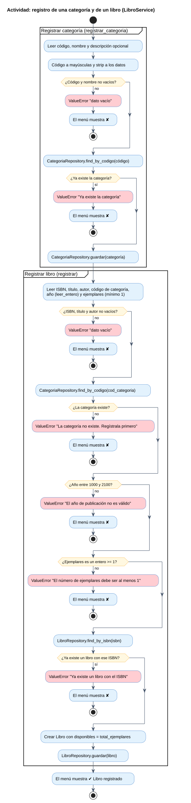

### E.3 Actividad: solicitud de préstamo
Todas las reglas de PrestamoService.prestar, en el orden del código.

- Archivo: `05_Diagramas_Comportamiento/03_Solicitud_Prestamo.puml`
- Imagen local: `img/03_Solicitud_Prestamo.svg` y `img/03_Solicitud_Prestamo.png`
- Ver en línea (SVG): https://www.plantuml.com/plantuml/svg/hLR9JXj14BtFLvIIYws0XG43CI9Wl2X8OH4ad29PpNJRxj3JFUh5n4JvYnnoo8LZ3fouvH8fyoVvabJFOW_2YY0E1mjtLVMyUlLUZVUC9TgwIC3AMlzC2HvowsZ_H3CCH2gmt0e6hT3oCQU4Di4KEJ21CH5u6FBaJW9bu2J4ElcU5aAbkEACwJ4FMIrEl-jgO2wvZ8ac4PWHeUgAoo4CY32i5A5iG9omFINj4OaGWEP4bE8jhTLLMmcbuVdwUcDzerKAaXIjdS2d062VX9T3hPoaUNfthRVQw_Y8qfJf_BJUs6YqL_2qmn6pf0_AUhtULhTUIYXNzrwsjbORmUSI2Aaicmy0R-fqDtsofpveHaowVfopPPeW6DD0LUWmODKI79pj7o7P0nQEo7jPwKgByPtikwTzf2RLxO0FeFBhPoyz39M4WT8HiGfQ-BTyUBZSwUnMmOwOX8fKLSI5EDgTpchpd0Z7kiYdXcTPEPVZvCPFzjasvZMx0X19yWCYXnWrWT_VllhXEoR634WUzQd6gZXWal91q7nd7D5SdR9O6MwLdjG6NDB-nQG_RQqo_M-A7v_bia9W7xcnx16WZufSBy2YsbF0n8p61Lh9aU5ug4A-ImWDjDfl3ywF7m6or9ZqbJQvoNIwEBBNP08QQUv7w1XYVEi3FdJQmvr0VXZx2YI2cIbOazm-0gt5AlRmbaMaKMo6ETh8dtfF6SqsRW6YPxkbe1qKd7UFsWUTOso6-nKqLlXSFLNJoQoY78TNEn2wE1kcvR7QHLiX94SvmTvWRSdhnhS9ZINK5leDPxPQVHfnH8H4NYTtO5pwj4KOUyClz3owkBcG5VzHDf3moVzedwmsDuzVFFz5dLa2Jg4Ex0EBOe7JfDp4Il8ByKYC8xodA4RZpShDujQU3Mr2Si5d-vXwgxASbRA4dcYYlroxY2ooTIsIsuZZ-6Ql155w3xy0cjoYTGkjtvVwvapgzPBM6wdjDCCv5MQ5IfZSKJvKS7BQNQxLQakGjvAPqLVCCVOG2Q14LuhtcqzB-wwL9eZG7vujGttxeV9nPphyrN6DLwOb_huvv7s1gVTnDmwvFwPgEqZPsqFwy1TFy0S0
- Ver en línea (PNG): https://www.plantuml.com/plantuml/png/hLR9JXj14BtFLvIIYws0XG43CI9Wl2X8OH4ad29PpNJRxj3JFUh5n4JvYnnoo8LZ3fouvH8fyoVvabJFOW_2YY0E1mjtLVMyUlLUZVUC9TgwIC3AMlzC2HvowsZ_H3CCH2gmt0e6hT3oCQU4Di4KEJ21CH5u6FBaJW9bu2J4ElcU5aAbkEACwJ4FMIrEl-jgO2wvZ8ac4PWHeUgAoo4CY32i5A5iG9omFINj4OaGWEP4bE8jhTLLMmcbuVdwUcDzerKAaXIjdS2d062VX9T3hPoaUNfthRVQw_Y8qfJf_BJUs6YqL_2qmn6pf0_AUhtULhTUIYXNzrwsjbORmUSI2Aaicmy0R-fqDtsofpveHaowVfopPPeW6DD0LUWmODKI79pj7o7P0nQEo7jPwKgByPtikwTzf2RLxO0FeFBhPoyz39M4WT8HiGfQ-BTyUBZSwUnMmOwOX8fKLSI5EDgTpchpd0Z7kiYdXcTPEPVZvCPFzjasvZMx0X19yWCYXnWrWT_VllhXEoR634WUzQd6gZXWal91q7nd7D5SdR9O6MwLdjG6NDB-nQG_RQqo_M-A7v_bia9W7xcnx16WZufSBy2YsbF0n8p61Lh9aU5ug4A-ImWDjDfl3ywF7m6or9ZqbJQvoNIwEBBNP08QQUv7w1XYVEi3FdJQmvr0VXZx2YI2cIbOazm-0gt5AlRmbaMaKMo6ETh8dtfF6SqsRW6YPxkbe1qKd7UFsWUTOso6-nKqLlXSFLNJoQoY78TNEn2wE1kcvR7QHLiX94SvmTvWRSdhnhS9ZINK5leDPxPQVHfnH8H4NYTtO5pwj4KOUyClz3owkBcG5VzHDf3moVzedwmsDuzVFFz5dLa2Jg4Ex0EBOe7JfDp4Il8ByKYC8xodA4RZpShDujQU3Mr2Si5d-vXwgxASbRA4dcYYlroxY2ooTIsIsuZZ-6Ql155w3xy0cjoYTGkjtvVwvapgzPBM6wdjDCCv5MQ5IfZSKJvKS7BQNQxLQakGjvAPqLVCCVOG2Q14LuhtcqzB-wwL9eZG7vujGttxeV9nPphyrN6DLwOb_huvv7s1gVTnDmwvFwPgEqZPsqFwy1TFy0S0
- Editar en línea: https://www.plantuml.com/plantuml/uml/hLR9JXj14BtFLvIIYws0XG43CI9Wl2X8OH4ad29PpNJRxj3JFUh5n4JvYnnoo8LZ3fouvH8fyoVvabJFOW_2YY0E1mjtLVMyUlLUZVUC9TgwIC3AMlzC2HvowsZ_H3CCH2gmt0e6hT3oCQU4Di4KEJ21CH5u6FBaJW9bu2J4ElcU5aAbkEACwJ4FMIrEl-jgO2wvZ8ac4PWHeUgAoo4CY32i5A5iG9omFINj4OaGWEP4bE8jhTLLMmcbuVdwUcDzerKAaXIjdS2d062VX9T3hPoaUNfthRVQw_Y8qfJf_BJUs6YqL_2qmn6pf0_AUhtULhTUIYXNzrwsjbORmUSI2Aaicmy0R-fqDtsofpveHaowVfopPPeW6DD0LUWmODKI79pj7o7P0nQEo7jPwKgByPtikwTzf2RLxO0FeFBhPoyz39M4WT8HiGfQ-BTyUBZSwUnMmOwOX8fKLSI5EDgTpchpd0Z7kiYdXcTPEPVZvCPFzjasvZMx0X19yWCYXnWrWT_VllhXEoR634WUzQd6gZXWal91q7nd7D5SdR9O6MwLdjG6NDB-nQG_RQqo_M-A7v_bia9W7xcnx16WZufSBy2YsbF0n8p61Lh9aU5ug4A-ImWDjDfl3ywF7m6or9ZqbJQvoNIwEBBNP08QQUv7w1XYVEi3FdJQmvr0VXZx2YI2cIbOazm-0gt5AlRmbaMaKMo6ETh8dtfF6SqsRW6YPxkbe1qKd7UFsWUTOso6-nKqLlXSFLNJoQoY78TNEn2wE1kcvR7QHLiX94SvmTvWRSdhnhS9ZINK5leDPxPQVHfnH8H4NYTtO5pwj4KOUyClz3owkBcG5VzHDf3moVzedwmsDuzVFFz5dLa2Jg4Ex0EBOe7JfDp4Il8ByKYC8xodA4RZpShDujQU3Mr2Si5d-vXwgxASbRA4dcYYlroxY2ooTIsIsuZZ-6Ql155w3xy0cjoYTGkjtvVwvapgzPBM6wdjDCCv5MQ5IfZSKJvKS7BQNQxLQakGjvAPqLVCCVOG2Q14LuhtcqzB-wwL9eZG7vujGttxeV9nPphyrN6DLwOb_huvv7s1gVTnDmwvFwPgEqZPsqFwy1TFy0S0
- Para incrustar:

```markdown
![E.3 Actividad: solicitud de préstamo](https://www.plantuml.com/plantuml/svg/hLR9JXj14BtFLvIIYws0XG43CI9Wl2X8OH4ad29PpNJRxj3JFUh5n4JvYnnoo8LZ3fouvH8fyoVvabJFOW_2YY0E1mjtLVMyUlLUZVUC9TgwIC3AMlzC2HvowsZ_H3CCH2gmt0e6hT3oCQU4Di4KEJ21CH5u6FBaJW9bu2J4ElcU5aAbkEACwJ4FMIrEl-jgO2wvZ8ac4PWHeUgAoo4CY32i5A5iG9omFINj4OaGWEP4bE8jhTLLMmcbuVdwUcDzerKAaXIjdS2d062VX9T3hPoaUNfthRVQw_Y8qfJf_BJUs6YqL_2qmn6pf0_AUhtULhTUIYXNzrwsjbORmUSI2Aaicmy0R-fqDtsofpveHaowVfopPPeW6DD0LUWmODKI79pj7o7P0nQEo7jPwKgByPtikwTzf2RLxO0FeFBhPoyz39M4WT8HiGfQ-BTyUBZSwUnMmOwOX8fKLSI5EDgTpchpd0Z7kiYdXcTPEPVZvCPFzjasvZMx0X19yWCYXnWrWT_VllhXEoR634WUzQd6gZXWal91q7nd7D5SdR9O6MwLdjG6NDB-nQG_RQqo_M-A7v_bia9W7xcnx16WZufSBy2YsbF0n8p61Lh9aU5ug4A-ImWDjDfl3ywF7m6or9ZqbJQvoNIwEBBNP08QQUv7w1XYVEi3FdJQmvr0VXZx2YI2cIbOazm-0gt5AlRmbaMaKMo6ETh8dtfF6SqsRW6YPxkbe1qKd7UFsWUTOso6-nKqLlXSFLNJoQoY78TNEn2wE1kcvR7QHLiX94SvmTvWRSdhnhS9ZINK5leDPxPQVHfnH8H4NYTtO5pwj4KOUyClz3owkBcG5VzHDf3moVzedwmsDuzVFFz5dLa2Jg4Ex0EBOe7JfDp4Il8ByKYC8xodA4RZpShDujQU3Mr2Si5d-vXwgxASbRA4dcYYlroxY2ooTIsIsuZZ-6Ql155w3xy0cjoYTGkjtvVwvapgzPBM6wdjDCCv5MQ5IfZSKJvKS7BQNQxLQakGjvAPqLVCCVOG2Q14LuhtcqzB-wwL9eZG7vujGttxeV9nPphyrN6DLwOb_huvv7s1gVTnDmwvFwPgEqZPsqFwy1TFy0S0)
```

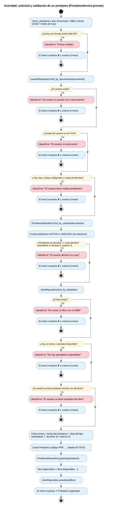

### E.4 Actividad: devolución y multa
Devolución, inventario, multa por retraso (COP 1.000 por día) y reserva cumplida.

- Archivo: `05_Diagramas_Comportamiento/04_Devolucion_Multa.puml`
- Imagen local: `img/04_Devolucion_Multa.svg` y `img/04_Devolucion_Multa.png`
- Ver en línea (SVG): https://www.plantuml.com/plantuml/svg/bLPDJoD74BtxLvGs5rjXBKDWip4YMSSpbf30Y_YI8Y6DYfcowMnFjzNTurqdoh_88Lhj8Hnps1EtN29b_ab-IQhd0nhiIEG2fhlgrUjNhygyiGwDAt89WzqaegMMHIgqIeuBwR3ZX9C4ezI9fSWm6qBMH9HtYZz3eK2AQwDX1MbvAzD2Qd-S-sHOQ0E6d46hE_QTK0iqc8EzmKo_5seECvIMWfkCPiY94wtS57CkQmJAu7vaZ7u_rf9XlzZTtTjzDGekiUBeLl1p1-1xJD_DZIvKreJ7Nqrs9f6_qIOZqvnkxxtQ6m_uD1AOQvMjfKqcazVnTX0GPa--6RtUsUly4f1Gsj5c0emKnL_xO2ztPvYJAfA58VuprtO8aiYmX7UPc7i59InC-KTrUQLMCAFq1hsmeVpTM3bEEe0RlUhjTuOd3TefBRGLJfjLVoPKbbolabHxt6w3py5Y1js__ug3Ca0VX7NqNG_S3J6uqZr-1_CUHz7Ey19bGJ7hR-35j8trtN_8JxK2vjtKUB7FsKCkm0yj_sH3C3U3yC-dt_o5TNhH8PM9sIOcAmIEBcyXYYylugFpj_UaRFdvlrZ5bXv3p8fAheAa-xzi9fNSIpOqcvwjhJIWrrfm8GI9z_q8M3z3k1fMg1OuH0sGdarsU4fpuUzCJIZ9xiUNINipP9hjqQgusI8yDmLAyHEQRcj7RwOZFzKRd2JijUhw7w69wXNmn41DhuQPi0kjnBKaosHoeRhXoPUmlGLEEvG9_KZvGYAJw5KAFAKGCAqASbIZ0oyDaMDIRvq3c6f5BRlgBB5abY8bxz6Pc1U6XLdZMIsyipgmdwBVPMXgp52PDdA3DcrKC6S0DOqVy65ci5sFl3AuIxJ1GmqdhdLAN49nXsMRLkEmSRpLWDEpOY55YbKruetQMj1hNtv6h_gQFLusHrBamj5-5LqphLE-XS4w6GOS6s8kbG3GFXEEBuvUzllzBLYYttK7K6DyWEt1O03ZjoTRLwfnuqayZGxZwNdSssyXdwevBz1atEFgjKtOusTnqfbGjHoFlv4Gd60JwIQhSaVxEnnmRXGt-dc-EArZxvrHi4c5IIp72z-6UXgkL9SxrE32Q7n-U3c2lBorViOvrBVR8XCSNnoV71r6emVtRfZqNo4ANcMQCS-mTVKPmPmKcVBkmKzhnDTnF_xUjAvAhl1g3jLIUSEV-V-0phy0
- Ver en línea (PNG): https://www.plantuml.com/plantuml/png/bLPDJoD74BtxLvGs5rjXBKDWip4YMSSpbf30Y_YI8Y6DYfcowMnFjzNTurqdoh_88Lhj8Hnps1EtN29b_ab-IQhd0nhiIEG2fhlgrUjNhygyiGwDAt89WzqaegMMHIgqIeuBwR3ZX9C4ezI9fSWm6qBMH9HtYZz3eK2AQwDX1MbvAzD2Qd-S-sHOQ0E6d46hE_QTK0iqc8EzmKo_5seECvIMWfkCPiY94wtS57CkQmJAu7vaZ7u_rf9XlzZTtTjzDGekiUBeLl1p1-1xJD_DZIvKreJ7Nqrs9f6_qIOZqvnkxxtQ6m_uD1AOQvMjfKqcazVnTX0GPa--6RtUsUly4f1Gsj5c0emKnL_xO2ztPvYJAfA58VuprtO8aiYmX7UPc7i59InC-KTrUQLMCAFq1hsmeVpTM3bEEe0RlUhjTuOd3TefBRGLJfjLVoPKbbolabHxt6w3py5Y1js__ug3Ca0VX7NqNG_S3J6uqZr-1_CUHz7Ey19bGJ7hR-35j8trtN_8JxK2vjtKUB7FsKCkm0yj_sH3C3U3yC-dt_o5TNhH8PM9sIOcAmIEBcyXYYylugFpj_UaRFdvlrZ5bXv3p8fAheAa-xzi9fNSIpOqcvwjhJIWrrfm8GI9z_q8M3z3k1fMg1OuH0sGdarsU4fpuUzCJIZ9xiUNINipP9hjqQgusI8yDmLAyHEQRcj7RwOZFzKRd2JijUhw7w69wXNmn41DhuQPi0kjnBKaosHoeRhXoPUmlGLEEvG9_KZvGYAJw5KAFAKGCAqASbIZ0oyDaMDIRvq3c6f5BRlgBB5abY8bxz6Pc1U6XLdZMIsyipgmdwBVPMXgp52PDdA3DcrKC6S0DOqVy65ci5sFl3AuIxJ1GmqdhdLAN49nXsMRLkEmSRpLWDEpOY55YbKruetQMj1hNtv6h_gQFLusHrBamj5-5LqphLE-XS4w6GOS6s8kbG3GFXEEBuvUzllzBLYYttK7K6DyWEt1O03ZjoTRLwfnuqayZGxZwNdSssyXdwevBz1atEFgjKtOusTnqfbGjHoFlv4Gd60JwIQhSaVxEnnmRXGt-dc-EArZxvrHi4c5IIp72z-6UXgkL9SxrE32Q7n-U3c2lBorViOvrBVR8XCSNnoV71r6emVtRfZqNo4ANcMQCS-mTVKPmPmKcVBkmKzhnDTnF_xUjAvAhl1g3jLIUSEV-V-0phy0
- Editar en línea: https://www.plantuml.com/plantuml/uml/bLPDJoD74BtxLvGs5rjXBKDWip4YMSSpbf30Y_YI8Y6DYfcowMnFjzNTurqdoh_88Lhj8Hnps1EtN29b_ab-IQhd0nhiIEG2fhlgrUjNhygyiGwDAt89WzqaegMMHIgqIeuBwR3ZX9C4ezI9fSWm6qBMH9HtYZz3eK2AQwDX1MbvAzD2Qd-S-sHOQ0E6d46hE_QTK0iqc8EzmKo_5seECvIMWfkCPiY94wtS57CkQmJAu7vaZ7u_rf9XlzZTtTjzDGekiUBeLl1p1-1xJD_DZIvKreJ7Nqrs9f6_qIOZqvnkxxtQ6m_uD1AOQvMjfKqcazVnTX0GPa--6RtUsUly4f1Gsj5c0emKnL_xO2ztPvYJAfA58VuprtO8aiYmX7UPc7i59InC-KTrUQLMCAFq1hsmeVpTM3bEEe0RlUhjTuOd3TefBRGLJfjLVoPKbbolabHxt6w3py5Y1js__ug3Ca0VX7NqNG_S3J6uqZr-1_CUHz7Ey19bGJ7hR-35j8trtN_8JxK2vjtKUB7FsKCkm0yj_sH3C3U3yC-dt_o5TNhH8PM9sIOcAmIEBcyXYYylugFpj_UaRFdvlrZ5bXv3p8fAheAa-xzi9fNSIpOqcvwjhJIWrrfm8GI9z_q8M3z3k1fMg1OuH0sGdarsU4fpuUzCJIZ9xiUNINipP9hjqQgusI8yDmLAyHEQRcj7RwOZFzKRd2JijUhw7w69wXNmn41DhuQPi0kjnBKaosHoeRhXoPUmlGLEEvG9_KZvGYAJw5KAFAKGCAqASbIZ0oyDaMDIRvq3c6f5BRlgBB5abY8bxz6Pc1U6XLdZMIsyipgmdwBVPMXgp52PDdA3DcrKC6S0DOqVy65ci5sFl3AuIxJ1GmqdhdLAN49nXsMRLkEmSRpLWDEpOY55YbKruetQMj1hNtv6h_gQFLusHrBamj5-5LqphLE-XS4w6GOS6s8kbG3GFXEEBuvUzllzBLYYttK7K6DyWEt1O03ZjoTRLwfnuqayZGxZwNdSssyXdwevBz1atEFgjKtOusTnqfbGjHoFlv4Gd60JwIQhSaVxEnnmRXGt-dc-EArZxvrHi4c5IIp72z-6UXgkL9SxrE32Q7n-U3c2lBorViOvrBVR8XCSNnoV71r6emVtRfZqNo4ANcMQCS-mTVKPmPmKcVBkmKzhnDTnF_xUjAvAhl1g3jLIUSEV-V-0phy0
- Para incrustar:

```markdown
![E.4 Actividad: devolución y multa](https://www.plantuml.com/plantuml/svg/bLPDJoD74BtxLvGs5rjXBKDWip4YMSSpbf30Y_YI8Y6DYfcowMnFjzNTurqdoh_88Lhj8Hnps1EtN29b_ab-IQhd0nhiIEG2fhlgrUjNhygyiGwDAt89WzqaegMMHIgqIeuBwR3ZX9C4ezI9fSWm6qBMH9HtYZz3eK2AQwDX1MbvAzD2Qd-S-sHOQ0E6d46hE_QTK0iqc8EzmKo_5seECvIMWfkCPiY94wtS57CkQmJAu7vaZ7u_rf9XlzZTtTjzDGekiUBeLl1p1-1xJD_DZIvKreJ7Nqrs9f6_qIOZqvnkxxtQ6m_uD1AOQvMjfKqcazVnTX0GPa--6RtUsUly4f1Gsj5c0emKnL_xO2ztPvYJAfA58VuprtO8aiYmX7UPc7i59InC-KTrUQLMCAFq1hsmeVpTM3bEEe0RlUhjTuOd3TefBRGLJfjLVoPKbbolabHxt6w3py5Y1js__ug3Ca0VX7NqNG_S3J6uqZr-1_CUHz7Ey19bGJ7hR-35j8trtN_8JxK2vjtKUB7FsKCkm0yj_sH3C3U3yC-dt_o5TNhH8PM9sIOcAmIEBcyXYYylugFpj_UaRFdvlrZ5bXv3p8fAheAa-xzi9fNSIpOqcvwjhJIWrrfm8GI9z_q8M3z3k1fMg1OuH0sGdarsU4fpuUzCJIZ9xiUNINipP9hjqQgusI8yDmLAyHEQRcj7RwOZFzKRd2JijUhw7w69wXNmn41DhuQPi0kjnBKaosHoeRhXoPUmlGLEEvG9_KZvGYAJw5KAFAKGCAqASbIZ0oyDaMDIRvq3c6f5BRlgBB5abY8bxz6Pc1U6XLdZMIsyipgmdwBVPMXgp52PDdA3DcrKC6S0DOqVy65ci5sFl3AuIxJ1GmqdhdLAN49nXsMRLkEmSRpLWDEpOY55YbKruetQMj1hNtv6h_gQFLusHrBamj5-5LqphLE-XS4w6GOS6s8kbG3GFXEEBuvUzllzBLYYttK7K6DyWEt1O03ZjoTRLwfnuqayZGxZwNdSssyXdwevBz1atEFgjKtOusTnqfbGjHoFlv4Gd60JwIQhSaVxEnnmRXGt-dc-EArZxvrHi4c5IIp72z-6UXgkL9SxrE32Q7n-U3c2lBorViOvrBVR8XCSNnoV71r6emVtRfZqNo4ANcMQCS-mTVKPmPmKcVBkmKzhnDTnF_xUjAvAhl1g3jLIUSEV-V-0phy0)
```

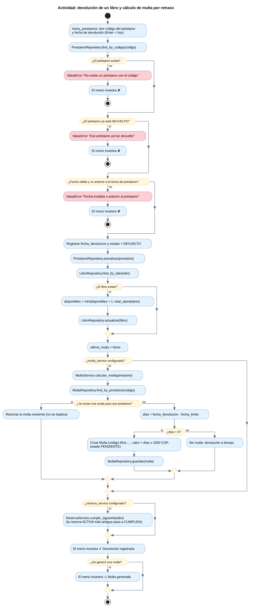

### E.5 Actividad: reserva
Reglas de ReservaService.reservar.

- Archivo: `05_Diagramas_Comportamiento/05_Reserva_Libro.puml`
- Imagen local: `img/05_Reserva_Libro.svg` y `img/05_Reserva_Libro.png`
- Ver en línea (SVG): https://www.plantuml.com/plantuml/svg/fPNDRjD04CVlVefHkJWIZThIbE8AKJUsfKgqI2tqX1HjlEDawNhNse-K2F4M73XmwGDmuiO5YRm9JyAkxGIZHgKYFbZEVEp-vhypcsDjY3AsvB0p65sWHZKZevTih6HWcE48SMxOZ5528r2D6oY25S1z46Wc0DzXMN7Yt12sIrow5ykntwQeNg2lcQY88YNeAQ7oXea958Hhx7We5iHoaqbXpadfzbQCy8u_LahU32MN2Xxjxm_s3-AEazIWPWuV0e0JabzFbBI2jk7fasmlIxn7AeggjUuE3WR37MTD62cbe7VIiYmxJ7Sx0Ttix5byk3S8FdOWX3Iu7i2jbAHFVR0NF8XA57RKogD7fIkRw0WueW8gS-lSHZw6qykJSvX3WVcKl1LXAeppFsz--tEOoddlA605X3z_PBKnbm8AgKfY9CJksJuxsqwI5pqmKnGG2jbpT8vcc2HxqHNX5bEdgeAj9fs9sUAMk_FUEd9nKSh1aIo-GsbH6qNWrvVFZcTcaSyGIElreTh8Aa11MH54RxGbYiaBhAHcHgfvls22ZiRpqQgqSFMrudTxsIOHy3tJ1Xy0VRwCzHsvpFOI8FyZumQbj6JkpAXqUdS8DSJ3rwTNhnu0sIbC-4opk6swTHEog1xIDH8pFHQXVtM5RORr_sHjSbjHVKDkhkSIo30KsBq_ADEL56pCKQymzUBhFSh-Uw48AelKsIhdSCF7DvAzlU3M25-Jt55-UV9pqa9QGLOtQTr2iHzaPsXAUM3PzovRDnVvQzbDIXug90hQmY7C5zyecqYuI2-t-_t-Oz_HVZoQObpjQpIQE5fALDWI-g0rB9zMcoYSC6-av2YeKOuTY_kN2du3
- Ver en línea (PNG): https://www.plantuml.com/plantuml/png/fPNDRjD04CVlVefHkJWIZThIbE8AKJUsfKgqI2tqX1HjlEDawNhNse-K2F4M73XmwGDmuiO5YRm9JyAkxGIZHgKYFbZEVEp-vhypcsDjY3AsvB0p65sWHZKZevTih6HWcE48SMxOZ5528r2D6oY25S1z46Wc0DzXMN7Yt12sIrow5ykntwQeNg2lcQY88YNeAQ7oXea958Hhx7We5iHoaqbXpadfzbQCy8u_LahU32MN2Xxjxm_s3-AEazIWPWuV0e0JabzFbBI2jk7fasmlIxn7AeggjUuE3WR37MTD62cbe7VIiYmxJ7Sx0Ttix5byk3S8FdOWX3Iu7i2jbAHFVR0NF8XA57RKogD7fIkRw0WueW8gS-lSHZw6qykJSvX3WVcKl1LXAeppFsz--tEOoddlA605X3z_PBKnbm8AgKfY9CJksJuxsqwI5pqmKnGG2jbpT8vcc2HxqHNX5bEdgeAj9fs9sUAMk_FUEd9nKSh1aIo-GsbH6qNWrvVFZcTcaSyGIElreTh8Aa11MH54RxGbYiaBhAHcHgfvls22ZiRpqQgqSFMrudTxsIOHy3tJ1Xy0VRwCzHsvpFOI8FyZumQbj6JkpAXqUdS8DSJ3rwTNhnu0sIbC-4opk6swTHEog1xIDH8pFHQXVtM5RORr_sHjSbjHVKDkhkSIo30KsBq_ADEL56pCKQymzUBhFSh-Uw48AelKsIhdSCF7DvAzlU3M25-Jt55-UV9pqa9QGLOtQTr2iHzaPsXAUM3PzovRDnVvQzbDIXug90hQmY7C5zyecqYuI2-t-_t-Oz_HVZoQObpjQpIQE5fALDWI-g0rB9zMcoYSC6-av2YeKOuTY_kN2du3
- Editar en línea: https://www.plantuml.com/plantuml/uml/fPNDRjD04CVlVefHkJWIZThIbE8AKJUsfKgqI2tqX1HjlEDawNhNse-K2F4M73XmwGDmuiO5YRm9JyAkxGIZHgKYFbZEVEp-vhypcsDjY3AsvB0p65sWHZKZevTih6HWcE48SMxOZ5528r2D6oY25S1z46Wc0DzXMN7Yt12sIrow5ykntwQeNg2lcQY88YNeAQ7oXea958Hhx7We5iHoaqbXpadfzbQCy8u_LahU32MN2Xxjxm_s3-AEazIWPWuV0e0JabzFbBI2jk7fasmlIxn7AeggjUuE3WR37MTD62cbe7VIiYmxJ7Sx0Ttix5byk3S8FdOWX3Iu7i2jbAHFVR0NF8XA57RKogD7fIkRw0WueW8gS-lSHZw6qykJSvX3WVcKl1LXAeppFsz--tEOoddlA605X3z_PBKnbm8AgKfY9CJksJuxsqwI5pqmKnGG2jbpT8vcc2HxqHNX5bEdgeAj9fs9sUAMk_FUEd9nKSh1aIo-GsbH6qNWrvVFZcTcaSyGIElreTh8Aa11MH54RxGbYiaBhAHcHgfvls22ZiRpqQgqSFMrudTxsIOHy3tJ1Xy0VRwCzHsvpFOI8FyZumQbj6JkpAXqUdS8DSJ3rwTNhnu0sIbC-4opk6swTHEog1xIDH8pFHQXVtM5RORr_sHjSbjHVKDkhkSIo30KsBq_ADEL56pCKQymzUBhFSh-Uw48AelKsIhdSCF7DvAzlU3M25-Jt55-UV9pqa9QGLOtQTr2iHzaPsXAUM3PzovRDnVvQzbDIXug90hQmY7C5zyecqYuI2-t-_t-Oz_HVZoQObpjQpIQE5fALDWI-g0rB9zMcoYSC6-av2YeKOuTY_kN2du3
- Para incrustar:

```markdown

```

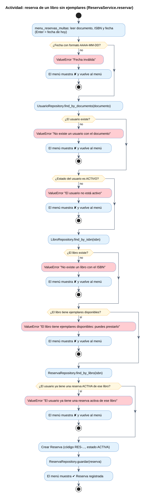

### E.6 Actividad: pago de multa
Flujo de MultaService.pagar.

- Archivo: `05_Diagramas_Comportamiento/06_Pago_Multa.puml`
- Imagen local: `img/06_Pago_Multa.svg` y `img/06_Pago_Multa.png`
- Ver en línea (SVG): https://www.plantuml.com/plantuml/svg/fPF1RjD048RlVefHkIHI5RKXASKHeYQ9kK1LWSG9oPfw9ydIzQurkquR46_1WGCNZXmuSUE2HDw49s7iECYYvSJHE_-_-yq_upCVa4DL63WwoIvmwRBdbGaO1HqCGP87lTOALGobr40HL1QXg2NGQvGlYTSwfu7KaVkHlzAsHCO2_0gLkzPs2GiqdZeLHGiKQ-fiECT2Nc6DfbDFcDtrr1d7S6yq6ezEaauH6wImWNSHm1FChvRiAgjQ-Vn-EandTSMn8cvFZySdu-cHdCuq5iwgMxOqJK_dnnr1rvq-J4w7u-Xz1yAwG7S3o4sp-ODQNESQnGNPAcFoaXBwh0dEns286FBjDwLtePesqqaKDw6-eD9v7Hnl1WjjLNQvoN9NYtkjgJ-9z09wFtyysq-3RhGFzBWFOKKMUjRr1KzmfhFPC7w5fgAvnCfmSEvQRMUKkRD0PazqC15hF3SWyDll8Y4V6E7Nfu-mWNL5Pas0RRMM-k3AYApIYx-XDiBbm_OpN2HFardoXyvll_uBR-uxvaL5zUAXmlzWkXMfh525Hhz5pkGMsT9zgeSjP_-rxJ6HprbVqex63y9DaDJZvckmyy6ZrY3dTw1zWERbjeD9r6mDw-Kg2E1K8j-FlLKSrZEeV8MiwwruW_Lg1BB4ejzHG5dtH3QGbxxBYaInTj8yWzn2IZEKlFqYT8NpWpg0PbUZ9eup-PG_FVeD
- Ver en línea (PNG): https://www.plantuml.com/plantuml/png/fPF1RjD048RlVefHkIHI5RKXASKHeYQ9kK1LWSG9oPfw9ydIzQurkquR46_1WGCNZXmuSUE2HDw49s7iECYYvSJHE_-_-yq_upCVa4DL63WwoIvmwRBdbGaO1HqCGP87lTOALGobr40HL1QXg2NGQvGlYTSwfu7KaVkHlzAsHCO2_0gLkzPs2GiqdZeLHGiKQ-fiECT2Nc6DfbDFcDtrr1d7S6yq6ezEaauH6wImWNSHm1FChvRiAgjQ-Vn-EandTSMn8cvFZySdu-cHdCuq5iwgMxOqJK_dnnr1rvq-J4w7u-Xz1yAwG7S3o4sp-ODQNESQnGNPAcFoaXBwh0dEns286FBjDwLtePesqqaKDw6-eD9v7Hnl1WjjLNQvoN9NYtkjgJ-9z09wFtyysq-3RhGFzBWFOKKMUjRr1KzmfhFPC7w5fgAvnCfmSEvQRMUKkRD0PazqC15hF3SWyDll8Y4V6E7Nfu-mWNL5Pas0RRMM-k3AYApIYx-XDiBbm_OpN2HFardoXyvll_uBR-uxvaL5zUAXmlzWkXMfh525Hhz5pkGMsT9zgeSjP_-rxJ6HprbVqex63y9DaDJZvckmyy6ZrY3dTw1zWERbjeD9r6mDw-Kg2E1K8j-FlLKSrZEeV8MiwwruW_Lg1BB4ejzHG5dtH3QGbxxBYaInTj8yWzn2IZEKlFqYT8NpWpg0PbUZ9eup-PG_FVeD
- Editar en línea: https://www.plantuml.com/plantuml/uml/fPF1RjD048RlVefHkIHI5RKXASKHeYQ9kK1LWSG9oPfw9ydIzQurkquR46_1WGCNZXmuSUE2HDw49s7iECYYvSJHE_-_-yq_upCVa4DL63WwoIvmwRBdbGaO1HqCGP87lTOALGobr40HL1QXg2NGQvGlYTSwfu7KaVkHlzAsHCO2_0gLkzPs2GiqdZeLHGiKQ-fiECT2Nc6DfbDFcDtrr1d7S6yq6ezEaauH6wImWNSHm1FChvRiAgjQ-Vn-EandTSMn8cvFZySdu-cHdCuq5iwgMxOqJK_dnnr1rvq-J4w7u-Xz1yAwG7S3o4sp-ODQNESQnGNPAcFoaXBwh0dEns286FBjDwLtePesqqaKDw6-eD9v7Hnl1WjjLNQvoN9NYtkjgJ-9z09wFtyysq-3RhGFzBWFOKKMUjRr1KzmfhFPC7w5fgAvnCfmSEvQRMUKkRD0PazqC15hF3SWyDll8Y4V6E7Nfu-mWNL5Pas0RRMM-k3AYApIYx-XDiBbm_OpN2HFardoXyvll_uBR-uxvaL5zUAXmlzWkXMfh525Hhz5pkGMsT9zgeSjP_-rxJ6HprbVqex63y9DaDJZvckmyy6ZrY3dTw1zWERbjeD9r6mDw-Kg2E1K8j-FlLKSrZEeV8MiwwruW_Lg1BB4ejzHG5dtH3QGbxxBYaInTj8yWzn2IZEKlFqYT8NpWpg0PbUZ9eup-PG_FVeD
- Para incrustar:

```markdown

```

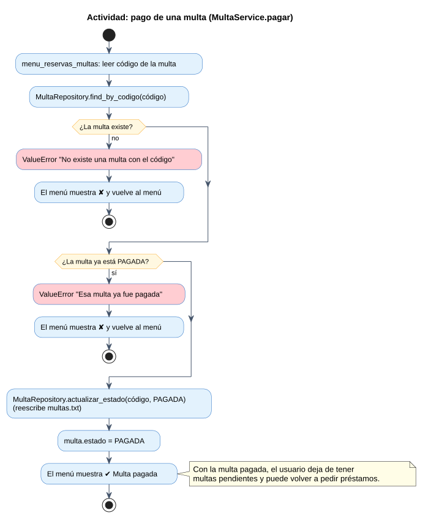

### F. Diagrama de secuencia
PrestamoService.prestar con fragmentos alt para cada validación.

- Archivo: `06_Diagrama_Secuencia.puml`
- Imagen local: `img/06_Diagrama_Secuencia.svg` y `img/06_Diagrama_Secuencia.png`
- Ver en línea (SVG): https://www.plantuml.com/plantuml/svg/bLQzRXj74ExlAGPCGo8K8IMYR2kXO96c00AKGeYsgm34ycv8hRstUzczeqqPUOiKATAeJE5ANLg-IPuaitjxVxGaA0t1k_bcvfl_UsrIfjCi5d1uidZ3sLgpc2tc66OeGyw2bAS2eNm-1OrhRbBDD6GI4htxcmp42jepZUxV7FM6XzXBtBFk1EOZbmaZis1kMAG-SRc65HC6QnAjCXcDb9QeuMNjVOGhbedqGidqYiK8vvepKPEVQwq-ZPHG6huxFkuVdvpNtU5lbZJ2bm1WHb7oa2TCfaCMVbnxZqvp_EF53nTlza1AHwWzuAX_qXyT4c3ALpZb4XlI5ozV7RuQaNIeFZS4myFXUDGFVWzObYgPnKlK0GjJ4hqp6TDS1Kdb45eJcQ9UiLkA6a8bZHBiLzcEKMQBn2VNT5h03BoRD3NtSkymitaJurrUOw8C9mxRtD9r4tL9sMPxcClhXxtjmMPxi2bVwdtCT0yZB0PEmM5pn308F5KuEAD8IQgIaE_k9HmLNUPwp-bs0a9Od5SvXOHJ-Y8LPfIuL7LXCXzUmHPM6Dwmod9XkWRaPYcxEGxQOriB6C2DsXOkPdDhFVVVVbYlOylBDon5c_w0D0gz1OLjaEc5mxKBj4YzGoutkpl18sQxS5xnUyz4XcFgSWsjYoQo5I0DaTTlQfFoDIclk8mMo-sY95lHxX2IC0S5lymdfgtWIadi12WZHwyGe7629-XT4UWphGQqnV5gdcDfnCbBaivpgE94PxXa1QfdCnmf60oWTJvwEtd_I-iRDj8IIdTtuFAjdc0r5eyfxN5hM3gZfYyIc91pJZb3i_3OPXelQsaK51-pynlREJ9GwPOXtB3j0z9d1P0I-07JFX33vQE6YLwz8HwCOrQBezphXe8f2JGBj-A2pW08mb1c8znaA59ws89Qvan9CymIvKoaF55b3chcBMlILM93ytOsS0hFomOJ8PEtktimcTFoQSWzSfCeoPUYQhPfFG5sPjlsnmO-RHJGBgHlfY1__Jzd85UYJMuJOTUGP-YDFJaB3jEhmgZwf_OEVeQZfydOPiCF62U2qUAgwtekJK2JpJ8p8NFh3QX7DBfIFrAwabxLBR1blcEn2FfvXItrycKRgSg0Pqtz9lmuxFMaNOOBiViQSwh1m2_7xo7QVMMcx4CxeDuP7LZoaKMSpX72Ywuz27PmuAZVfHBH4I1VVTibeKQxrrl5AIPlnI7qvszS6xPnJTmET_SHNolx-g3NwnKdetP37CykUEATvjIkYMb4DwVmN8cdGtl2QWqnQ3mTbEtXsvzsNCO4loLZ_desk_yjDTzUZGgdzbvCyjVbgVtthpyeoE8BiFWmZF8vZx1n2wMYFyeEENsy08obwwQGnLow9GFe-e0gH2dP_KEI9CrelT2Bgar8qIvFj6x8-v_5S96AOH_m9ziOr1vvma0o-ebtTwPd2O5b4BocV_In6_m7
- Ver en línea (PNG): https://www.plantuml.com/plantuml/png/bLQzRXj74ExlAGPCGo8K8IMYR2kXO96c00AKGeYsgm34ycv8hRstUzczeqqPUOiKATAeJE5ANLg-IPuaitjxVxGaA0t1k_bcvfl_UsrIfjCi5d1uidZ3sLgpc2tc66OeGyw2bAS2eNm-1OrhRbBDD6GI4htxcmp42jepZUxV7FM6XzXBtBFk1EOZbmaZis1kMAG-SRc65HC6QnAjCXcDb9QeuMNjVOGhbedqGidqYiK8vvepKPEVQwq-ZPHG6huxFkuVdvpNtU5lbZJ2bm1WHb7oa2TCfaCMVbnxZqvp_EF53nTlza1AHwWzuAX_qXyT4c3ALpZb4XlI5ozV7RuQaNIeFZS4myFXUDGFVWzObYgPnKlK0GjJ4hqp6TDS1Kdb45eJcQ9UiLkA6a8bZHBiLzcEKMQBn2VNT5h03BoRD3NtSkymitaJurrUOw8C9mxRtD9r4tL9sMPxcClhXxtjmMPxi2bVwdtCT0yZB0PEmM5pn308F5KuEAD8IQgIaE_k9HmLNUPwp-bs0a9Od5SvXOHJ-Y8LPfIuL7LXCXzUmHPM6Dwmod9XkWRaPYcxEGxQOriB6C2DsXOkPdDhFVVVVbYlOylBDon5c_w0D0gz1OLjaEc5mxKBj4YzGoutkpl18sQxS5xnUyz4XcFgSWsjYoQo5I0DaTTlQfFoDIclk8mMo-sY95lHxX2IC0S5lymdfgtWIadi12WZHwyGe7629-XT4UWphGQqnV5gdcDfnCbBaivpgE94PxXa1QfdCnmf60oWTJvwEtd_I-iRDj8IIdTtuFAjdc0r5eyfxN5hM3gZfYyIc91pJZb3i_3OPXelQsaK51-pynlREJ9GwPOXtB3j0z9d1P0I-07JFX33vQE6YLwz8HwCOrQBezphXe8f2JGBj-A2pW08mb1c8znaA59ws89Qvan9CymIvKoaF55b3chcBMlILM93ytOsS0hFomOJ8PEtktimcTFoQSWzSfCeoPUYQhPfFG5sPjlsnmO-RHJGBgHlfY1__Jzd85UYJMuJOTUGP-YDFJaB3jEhmgZwf_OEVeQZfydOPiCF62U2qUAgwtekJK2JpJ8p8NFh3QX7DBfIFrAwabxLBR1blcEn2FfvXItrycKRgSg0Pqtz9lmuxFMaNOOBiViQSwh1m2_7xo7QVMMcx4CxeDuP7LZoaKMSpX72Ywuz27PmuAZVfHBH4I1VVTibeKQxrrl5AIPlnI7qvszS6xPnJTmET_SHNolx-g3NwnKdetP37CykUEATvjIkYMb4DwVmN8cdGtl2QWqnQ3mTbEtXsvzsNCO4loLZ_desk_yjDTzUZGgdzbvCyjVbgVtthpyeoE8BiFWmZF8vZx1n2wMYFyeEENsy08obwwQGnLow9GFe-e0gH2dP_KEI9CrelT2Bgar8qIvFj6x8-v_5S96AOH_m9ziOr1vvma0o-ebtTwPd2O5b4BocV_In6_m7
- Editar en línea: https://www.plantuml.com/plantuml/uml/bLQzRXj74ExlAGPCGo8K8IMYR2kXO96c00AKGeYsgm34ycv8hRstUzczeqqPUOiKATAeJE5ANLg-IPuaitjxVxGaA0t1k_bcvfl_UsrIfjCi5d1uidZ3sLgpc2tc66OeGyw2bAS2eNm-1OrhRbBDD6GI4htxcmp42jepZUxV7FM6XzXBtBFk1EOZbmaZis1kMAG-SRc65HC6QnAjCXcDb9QeuMNjVOGhbedqGidqYiK8vvepKPEVQwq-ZPHG6huxFkuVdvpNtU5lbZJ2bm1WHb7oa2TCfaCMVbnxZqvp_EF53nTlza1AHwWzuAX_qXyT4c3ALpZb4XlI5ozV7RuQaNIeFZS4myFXUDGFVWzObYgPnKlK0GjJ4hqp6TDS1Kdb45eJcQ9UiLkA6a8bZHBiLzcEKMQBn2VNT5h03BoRD3NtSkymitaJurrUOw8C9mxRtD9r4tL9sMPxcClhXxtjmMPxi2bVwdtCT0yZB0PEmM5pn308F5KuEAD8IQgIaE_k9HmLNUPwp-bs0a9Od5SvXOHJ-Y8LPfIuL7LXCXzUmHPM6Dwmod9XkWRaPYcxEGxQOriB6C2DsXOkPdDhFVVVVbYlOylBDon5c_w0D0gz1OLjaEc5mxKBj4YzGoutkpl18sQxS5xnUyz4XcFgSWsjYoQo5I0DaTTlQfFoDIclk8mMo-sY95lHxX2IC0S5lymdfgtWIadi12WZHwyGe7629-XT4UWphGQqnV5gdcDfnCbBaivpgE94PxXa1QfdCnmf60oWTJvwEtd_I-iRDj8IIdTtuFAjdc0r5eyfxN5hM3gZfYyIc91pJZb3i_3OPXelQsaK51-pynlREJ9GwPOXtB3j0z9d1P0I-07JFX33vQE6YLwz8HwCOrQBezphXe8f2JGBj-A2pW08mb1c8znaA59ws89Qvan9CymIvKoaF55b3chcBMlILM93ytOsS0hFomOJ8PEtktimcTFoQSWzSfCeoPUYQhPfFG5sPjlsnmO-RHJGBgHlfY1__Jzd85UYJMuJOTUGP-YDFJaB3jEhmgZwf_OEVeQZfydOPiCF62U2qUAgwtekJK2JpJ8p8NFh3QX7DBfIFrAwabxLBR1blcEn2FfvXItrycKRgSg0Pqtz9lmuxFMaNOOBiViQSwh1m2_7xo7QVMMcx4CxeDuP7LZoaKMSpX72Ywuz27PmuAZVfHBH4I1VVTibeKQxrrl5AIPlnI7qvszS6xPnJTmET_SHNolx-g3NwnKdetP37CykUEATvjIkYMb4DwVmN8cdGtl2QWqnQ3mTbEtXsvzsNCO4loLZ_desk_yjDTzUZGgdzbvCyjVbgVtthpyeoE8BiFWmZF8vZx1n2wMYFyeEENsy08obwwQGnLow9GFe-e0gH2dP_KEI9CrelT2Bgar8qIvFj6x8-v_5S96AOH_m9ziOr1vvma0o-ebtTwPd2O5b4BocV_In6_m7
- Para incrustar:

```markdown
![F. Diagrama de secuencia](https://www.plantuml.com/plantuml/svg/bLQzRXj74ExlAGPCGo8K8IMYR2kXO96c00AKGeYsgm34ycv8hRstUzczeqqPUOiKATAeJE5ANLg-IPuaitjxVxGaA0t1k_bcvfl_UsrIfjCi5d1uidZ3sLgpc2tc66OeGyw2bAS2eNm-1OrhRbBDD6GI4htxcmp42jepZUxV7FM6XzXBtBFk1EOZbmaZis1kMAG-SRc65HC6QnAjCXcDb9QeuMNjVOGhbedqGidqYiK8vvepKPEVQwq-ZPHG6huxFkuVdvpNtU5lbZJ2bm1WHb7oa2TCfaCMVbnxZqvp_EF53nTlza1AHwWzuAX_qXyT4c3ALpZb4XlI5ozV7RuQaNIeFZS4myFXUDGFVWzObYgPnKlK0GjJ4hqp6TDS1Kdb45eJcQ9UiLkA6a8bZHBiLzcEKMQBn2VNT5h03BoRD3NtSkymitaJurrUOw8C9mxRtD9r4tL9sMPxcClhXxtjmMPxi2bVwdtCT0yZB0PEmM5pn308F5KuEAD8IQgIaE_k9HmLNUPwp-bs0a9Od5SvXOHJ-Y8LPfIuL7LXCXzUmHPM6Dwmod9XkWRaPYcxEGxQOriB6C2DsXOkPdDhFVVVVbYlOylBDon5c_w0D0gz1OLjaEc5mxKBj4YzGoutkpl18sQxS5xnUyz4XcFgSWsjYoQo5I0DaTTlQfFoDIclk8mMo-sY95lHxX2IC0S5lymdfgtWIadi12WZHwyGe7629-XT4UWphGQqnV5gdcDfnCbBaivpgE94PxXa1QfdCnmf60oWTJvwEtd_I-iRDj8IIdTtuFAjdc0r5eyfxN5hM3gZfYyIc91pJZb3i_3OPXelQsaK51-pynlREJ9GwPOXtB3j0z9d1P0I-07JFX33vQE6YLwz8HwCOrQBezphXe8f2JGBj-A2pW08mb1c8znaA59ws89Qvan9CymIvKoaF55b3chcBMlILM93ytOsS0hFomOJ8PEtktimcTFoQSWzSfCeoPUYQhPfFG5sPjlsnmO-RHJGBgHlfY1__Jzd85UYJMuJOTUGP-YDFJaB3jEhmgZwf_OEVeQZfydOPiCF62U2qUAgwtekJK2JpJ8p8NFh3QX7DBfIFrAwabxLBR1blcEn2FfvXItrycKRgSg0Pqtz9lmuxFMaNOOBiViQSwh1m2_7xo7QVMMcx4CxeDuP7LZoaKMSpX72Ywuz27PmuAZVfHBH4I1VVTibeKQxrrl5AIPlnI7qvszS6xPnJTmET_SHNolx-g3NwnKdetP37CykUEATvjIkYMb4DwVmN8cdGtl2QWqnQ3mTbEtXsvzsNCO4loLZ_desk_yjDTzUZGgdzbvCyjVbgVtthpyeoE8BiFWmZF8vZx1n2wMYFyeEENsy08obwwQGnLow9GFe-e0gH2dP_KEI9CrelT2Bgar8qIvFj6x8-v_5S96AOH_m9ziOr1vvma0o-ebtTwPd2O5b4BocV_In6_m7)
```

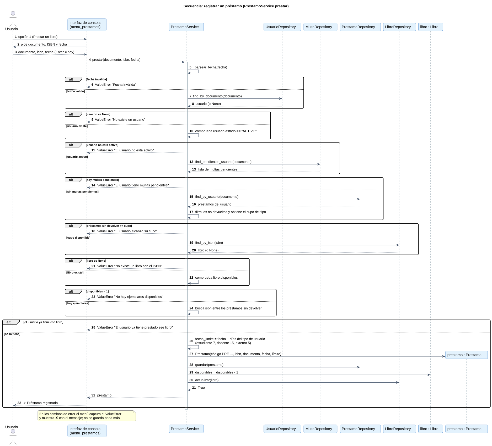

## Validación realizada

- Los 14 archivos `.puml` pasaron la verificación de sintaxis de PlantUML 1.2024.7 (`-checkonly -failonerror`) y se renderizaron a SVG y PNG sin errores.
- Los enlaces se codificaron con el algoritmo estándar de PlantUML y se comprobó, decodificándolos con el propio PlantUML, que cada enlace contiene el código del archivo correspondiente.
- **No se abrieron los enlaces en el servidor de plantuml.com**, porque el entorno donde se generaron no tiene acceso a ese sitio. Si alguno no carga, usa la imagen de `img/` o pega el `.puml` en el editor en línea.
- Cada clase, método y atributo de los diagramas se tomó de `SGB.py`. No se agregó nada que no exista en el código.

## Diferencias entre el PDF y el código (no corregidas, solo señaladas)

1. **`ArchivoUtil`:** el PDF define 4 métodos (`leer_lineas`, `escribir_linea`, `reescribir`, `generar_codigo`). El código añade `existe` y `crear_si_no_existe`.
2. **Repositorios:** el código añade `find_all` en préstamos, multas y reservas, y `find_by_codigo` en multas y reservas. `MultaRepository` recibe además el `PrestamoRepository` en su constructor, para poder resolver `find_pendientes_usuario(doc)`.
3. **Servicios:** el código añade `LibroService.listar_categorias`, `LibroService.listar_disponibles` y `ReservaService.cumplir_siguiente`. `PrestamoService` recibe 6 dependencias (3 opcionales) y guarda `ultima_multa`.
4. **Cálculo de multa:** el PDF asigna `calcular_multa` a `MultaService`; en el código lo invoca `PrestamoService.devolver`, que depende de `MultaService` y de `ReservaService`.
5. **Menús:** son funciones, no clases, por eso solo aparecen en `03c_Arquitectura_Capas.puml`.
6. **`__str__`:** las clases del modelo lo implementan, pero se omitió en los diagramas para no saturarlos.
7. **Dominio:** no se dibujan las claves foráneas (`cod_categoria`, `isbn`, `num_documento`, `cod_prestamo`); en el código las relaciones se guardan por clave, no como referencias a objetos.
8. **Morosidad:** `AnalisisDatosService.morosidad_por_tipo` cuenta además los préstamos ACTIVOS ya atrasados a la fecha de corte; el PDF (7.2.3) solo menciona VENCIDO y devuelto tarde.
9. **Datos de prueba:** en los datos precargados, `disponibles` no coincide con los préstamos activos (por ejemplo, *Cien anios de soledad* tiene 5 ejemplares y 3 disponibles, pero sus dos préstamos están DEVUELTOS). El diagrama de objetos refleja los datos tal como están.
