# Diagramas UML del SGB (PlantUML)

Diagramas del Sistema de Gestión Bibliotecaria, hechos a partir del código Python del proyecto (`SGB.py` / `SGB.ipynb`).

## Estructura

```text
Diagramas_SGB/
├── 01_Dominio_Parcial.puml
├── 02_Dominio_Completo.puml
├── 03_Diagrama_Clases.puml            (+ 03a, 03b y 03c: subdiagramas)
├── 04_Diagrama_Objetos.puml
├── 05_Diagramas_Comportamiento/       (6 diagramas de actividad)
├── 06_Diagrama_Secuencia.puml
├── img/                               (cada diagrama en PNG y SVG)
├── ENLACES.md                         (enlaces para ver y editar en línea)
└── README.md
```

## Cómo abrir o modificar el código

- **VS Code:** extensión *PlantUML* (jebbs); `Alt+D` abre la vista previa. Necesita Java y Graphviz.
- **En línea:** pega el `.puml` en https://www.plantuml.com/plantuml/uml/ o usa los enlaces de `ENLACES.md`.
- **Línea de comandos:** `java -jar plantuml.jar -tpng archivo.puml`.
- Si cambias un `.puml`, vuelve a generar su imagen en `img/`.

## Diagramas

### A. Dominio parcial
Usuario, Libro, Prestamo y Multa con sus multiplicidades.

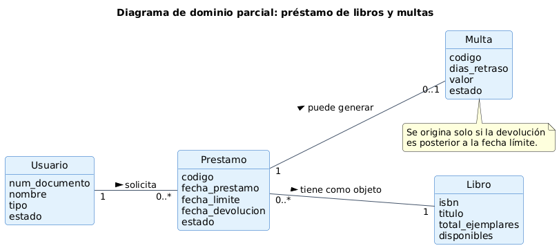

Código fuente: [`01_Dominio_Parcial.puml`](01_Dominio_Parcial.puml)

### B. Dominio completo
Las seis entidades, atributos y multiplicidades.

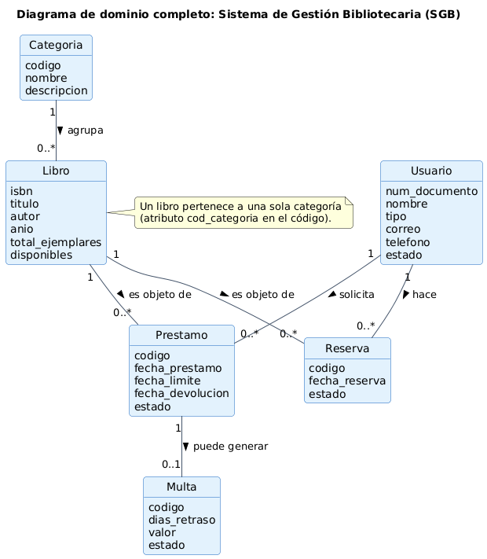

Código fuente: [`02_Dominio_Completo.puml`](02_Dominio_Completo.puml)

### C. Diagrama de clases general
Las tres capas con enumeraciones, métodos y dependencias.

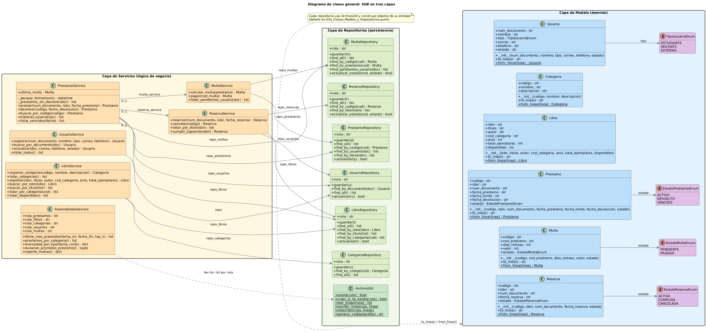

Código fuente: [`03_Diagrama_Clases.puml`](03_Diagrama_Clases.puml)

### C.1 Clases: Modelo y Repositorios
Cada repositorio con ArchivoUtil y su entidad.

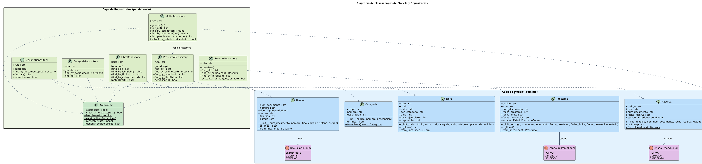

Código fuente: [`03a_Clases_Modelo_y_Repositorios.puml`](03a_Clases_Modelo_y_Repositorios.puml)

### C.2 Clases: Servicios
Servicios y dependencias recibidas por constructor.

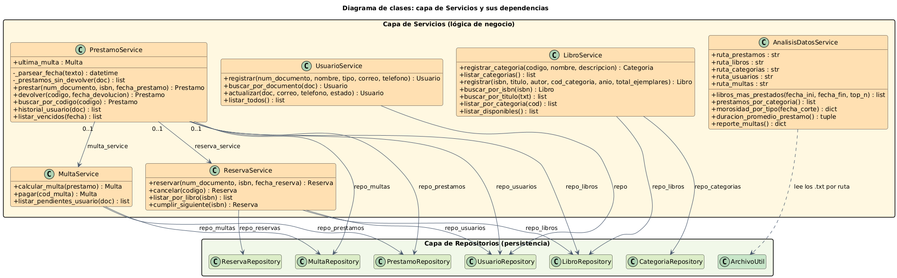

Código fuente: [`03b_Clases_Servicios.puml`](03b_Clases_Servicios.puml)

### C.3 Arquitectura de capas
Interfaz, servicios, repositorios, modelo y archivos .txt.

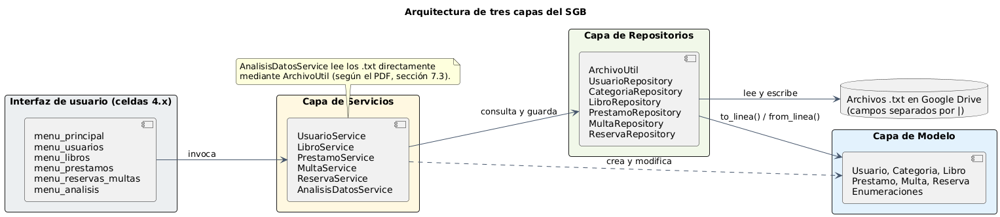

Código fuente: [`03c_Arquitectura_Capas.puml`](03c_Arquitectura_Capas.puml)

### D. Diagrama de objetos
Instancias de los datos de prueba.

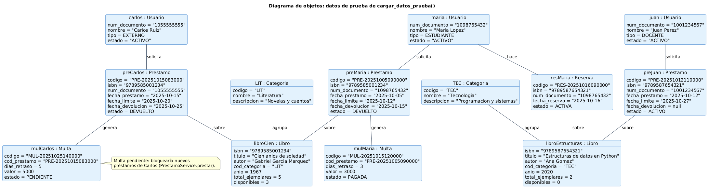

Código fuente: [`04_Diagrama_Objetos.puml`](04_Diagrama_Objetos.puml)

### E.1 Actividad: registro de usuario
Validaciones de UsuarioService.registrar.

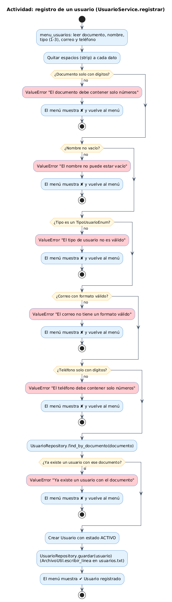

Código fuente: [`05_Diagramas_Comportamiento/01_Registro_Usuario.puml`](05_Diagramas_Comportamiento/01_Registro_Usuario.puml)

### E.2 Actividad: registro de categoría y libro
LibroService.registrar_categoria y registrar.

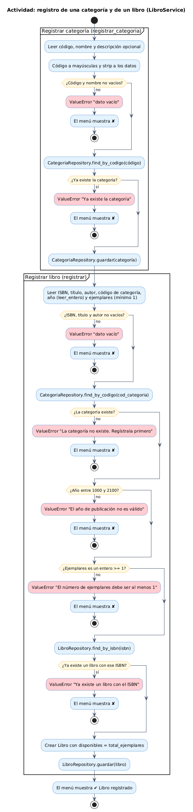

Código fuente: [`05_Diagramas_Comportamiento/02_Registro_Libro.puml`](05_Diagramas_Comportamiento/02_Registro_Libro.puml)

### E.3 Actividad: solicitud de préstamo
Reglas de PrestamoService.prestar.

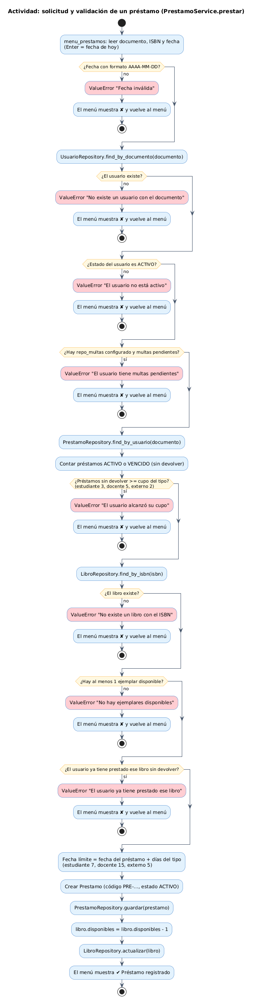

Código fuente: [`05_Diagramas_Comportamiento/03_Solicitud_Prestamo.puml`](05_Diagramas_Comportamiento/03_Solicitud_Prestamo.puml)

### E.4 Actividad: devolución y multa
Devolución, inventario, multa y reserva cumplida.

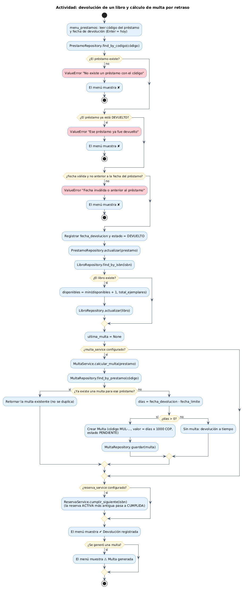

Código fuente: [`05_Diagramas_Comportamiento/04_Devolucion_Multa.puml`](05_Diagramas_Comportamiento/04_Devolucion_Multa.puml)

### E.5 Actividad: reserva
Reglas de ReservaService.reservar.

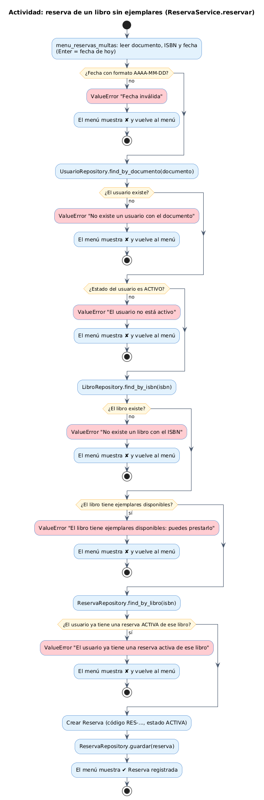

Código fuente: [`05_Diagramas_Comportamiento/05_Reserva_Libro.puml`](05_Diagramas_Comportamiento/05_Reserva_Libro.puml)

### E.6 Actividad: pago de multa
MultaService.pagar.

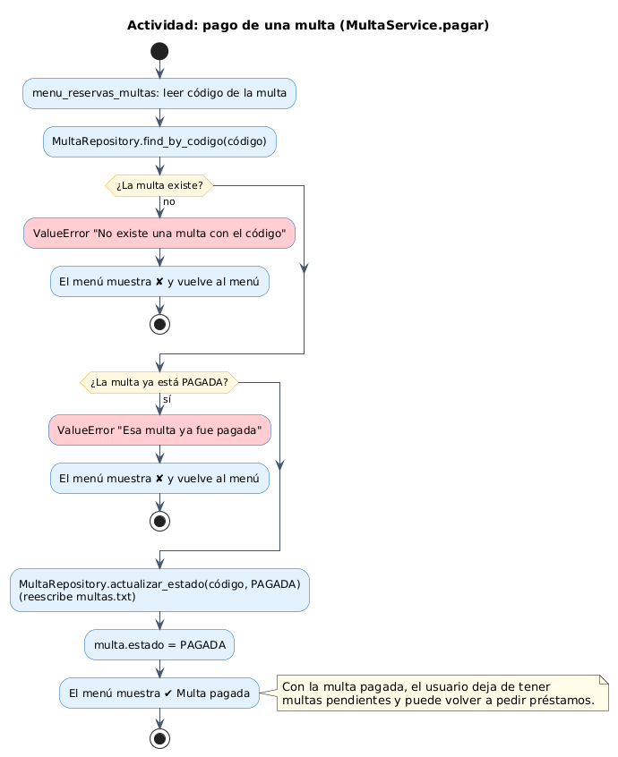

Código fuente: [`05_Diagramas_Comportamiento/06_Pago_Multa.puml`](05_Diagramas_Comportamiento/06_Pago_Multa.puml)

### F. Diagrama de secuencia
PrestamoService.prestar con fragmentos alt.

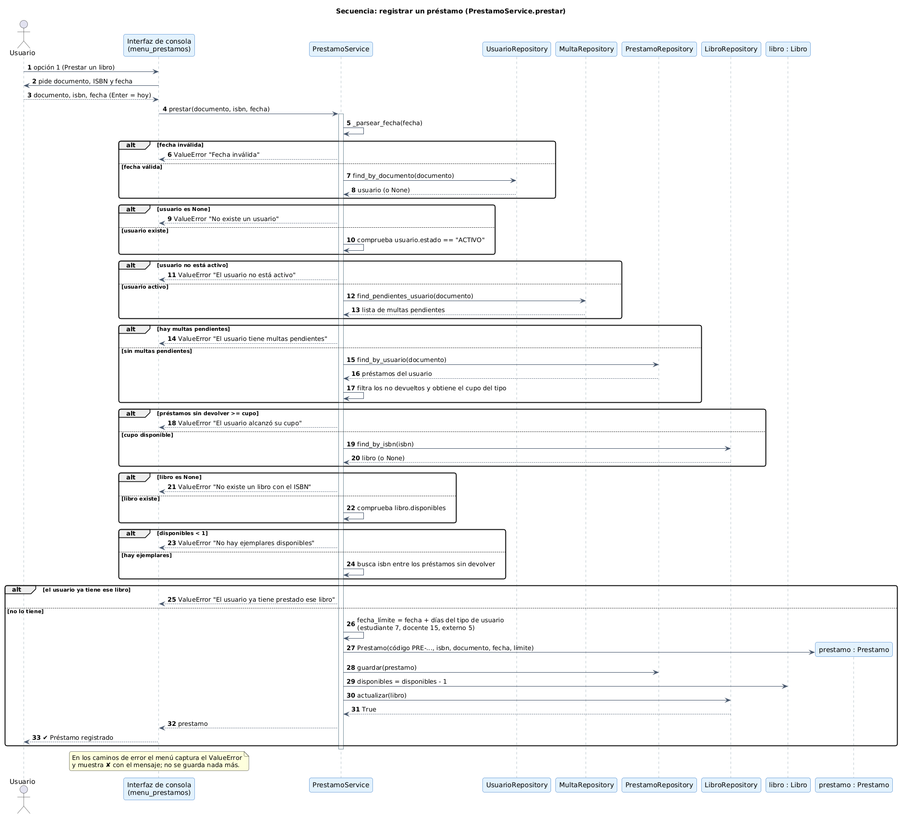

Código fuente: [`06_Diagrama_Secuencia.puml`](06_Diagrama_Secuencia.puml)

## Validación realizada

- Los 14 archivos `.puml` pasaron la verificación de sintaxis de PlantUML 1.2024.7 (`-checkonly -failonerror`) y se renderizaron a SVG y PNG sin errores.
- Los enlaces se codificaron con el algoritmo estándar de PlantUML y se comprobó, decodificándolos con el propio PlantUML, que cada enlace contiene el código del archivo correspondiente.
- **No se abrieron los enlaces en el servidor de plantuml.com**, porque el entorno donde se generaron no tiene acceso a ese sitio. Si alguno no carga, usa la imagen de `img/` o pega el `.puml` en el editor en línea.
- Cada clase, método y atributo de los diagramas se tomó de `SGB.py`. No se agregó nada que no exista en el código.

## Diferencias entre el PDF y el código (no corregidas, solo señaladas)

1. **`ArchivoUtil`:** el PDF define 4 métodos (`leer_lineas`, `escribir_linea`, `reescribir`, `generar_codigo`). El código añade `existe` y `crear_si_no_existe`.
2. **Repositorios:** el código añade `find_all` en préstamos, multas y reservas, y `find_by_codigo` en multas y reservas. `MultaRepository` recibe además el `PrestamoRepository` en su constructor, para poder resolver `find_pendientes_usuario(doc)`.
3. **Servicios:** el código añade `LibroService.listar_categorias`, `LibroService.listar_disponibles` y `ReservaService.cumplir_siguiente`. `PrestamoService` recibe 6 dependencias (3 opcionales) y guarda `ultima_multa`.
4. **Cálculo de multa:** el PDF asigna `calcular_multa` a `MultaService`; en el código lo invoca `PrestamoService.devolver`, que depende de `MultaService` y de `ReservaService`.
5. **Menús:** son funciones, no clases, por eso solo aparecen en `03c_Arquitectura_Capas.puml`.
6. **`__str__`:** las clases del modelo lo implementan, pero se omitió en los diagramas para no saturarlos.
7. **Dominio:** no se dibujan las claves foráneas (`cod_categoria`, `isbn`, `num_documento`, `cod_prestamo`); en el código las relaciones se guardan por clave, no como referencias a objetos.
8. **Morosidad:** `AnalisisDatosService.morosidad_por_tipo` cuenta además los préstamos ACTIVOS ya atrasados a la fecha de corte; el PDF (7.2.3) solo menciona VENCIDO y devuelto tarde.
9. **Datos de prueba:** en los datos precargados, `disponibles` no coincide con los préstamos activos (por ejemplo, *Cien anios de soledad* tiene 5 ejemplares y 3 disponibles, pero sus dos préstamos están DEVUELTOS). El diagrama de objetos refleja los datos tal como están.
